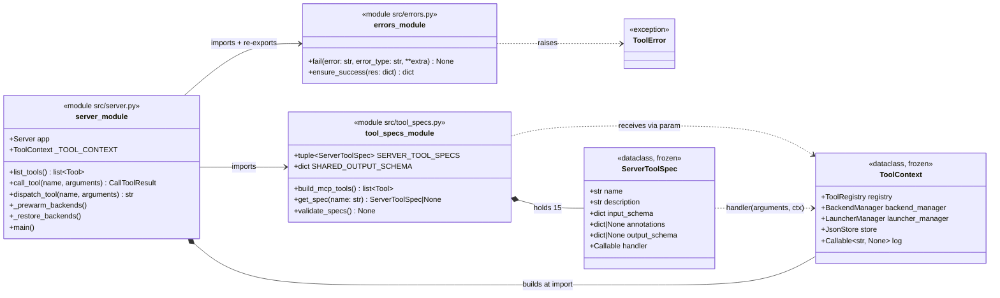
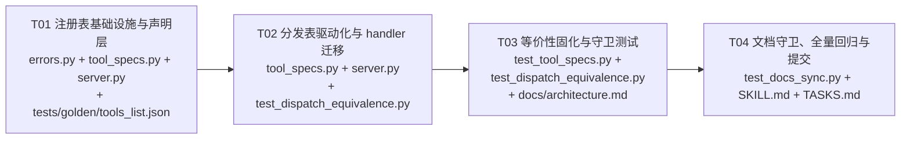

# P1-04「声明式注册表」增量重构设计

> **文档性质**：架构增量设计（设计文档，**不含实现代码**）。配套增量任务列表见 §8。
> **评审基线**：HEAD `4edead9`（含 P0 修复 `4dc8b31`：install 自装授权门禁 + 命令白名单）。
> **测试基线**：`pyenv 3.12.0 python -m pytest -q` → **183 passed**（2026-10-16 实测，**9 个贡献用例的文件**）。
> **文件数口径（QA 2026-10-17 补充确认）**：`tests/` 下物理上有 **10 个** `test_*.py`，其中 `tests/test_e2e_install_gate.py`（随 `4dc8b31` 提交，142 行）**collect 0 条用例**——文件首行自述「一次性手工脚本，非 pytest 用例」，须手工 `python tests/test_e2e_install_gate.py` 跑。因此「9 个文件」仅在「贡献 pytest 用例的文件」口径下成立；引用时建议写成「9 个用例文件 + 1 个手工 E2E 脚本」（`docs/architecture.md:88` 已采用此写法）。
> **上游输入**：`docs/architecture_review_2026-10-16.md` 的 ARC-P1-04；`docs/test_health_review_2026-10-16.md`（QA）。
> **行号说明（2026-10-17 二次修订，NE-4 清理）**：本文所有 `file:line` 均在设计时点的 `4edead9` 上逐行核对过（不复用评审报告里的旧行号）。**但 P1-04 重构（M00–M08）已把 `server.py` 从 1020 行降到 464 行**——因此 §1–§7 里的 `server.py:NNN` 全部是**重构前基线**（`ee252eb~1`，即 M01 的父提交）的行号，**不是当前 HEAD 的位置**。重构后的对应位置见下方 **§0 映射表**（逐条实测核对）；§12 核验记录里的 `server.py:NNN` 为重构后新锚点（已就地标注「新」）。本文按「历史留档」体例保留旧行号不改写正文——§1 的维护点清单是**针对重构前代码的证据**（如「`Tool` 字面量占 :158-431 约 273 行」正是「9 个维护点」论断的支撑），改写成新行号会破坏证据链。

---

## 0. `server.py` 行号口径与旧→新映射表（NE-4 清理，2026-10-17）

**§1–§7 的 `server.py:NNN` = 重构前基线**（`ee252eb~1`，1020 行版本）。P1-04 后（HEAD，464 行）的对应位置：

| 本文引用（旧，`server.py`） | 重构后位置（HEAD `fce1b4b` 实测复核；`a2a8079` 采集后 P1-03 S2–S6 对 `server.py`/`tool_specs.py` 仅行内替换、行数不变，锚点不漂） |
|---|---|
| `:28-31` `ToolAnnotations` 可选导入 | `tool_specs.py:23-26` |
| `:73-91` `TOOL_ANNOTATION_HINTS` | `tool_specs.py:351-657` `SERVER_TOOL_SPECS`（annotations 与工具同条记录，表已删除） |
| `:88` `set_backend_log_level` 的 `{}` | `tool_specs.py:560` `annotations={}` |
| `:96-99` outputSchema 约束注释 | `tool_specs.py:79-85`（注释原文随常量搬入） |
| `:100-105` `SHARED_OUTPUT_SCHEMA` | `tool_specs.py:86-91` |
| `:108-126` `_needs_destructive_confirm` | `tool_specs.py:102-120` |
| `:158-431` 15 个 `Tool(...)` 字面量 | `tool_specs.py:351-657` `SERVER_TOOL_SPECS` |
| `:171` / `:185` `kind` 的 driver 文案 | `tool_specs.py:366` / `:383`（P1-04 时保留原文「如 app、mcp、driver」；**2026-10-17 §3.1 #20 已修正为「launcher」**，NE-5 注释在其上一行 `:365` / `:382`） |
| `:435` `if hints:` 真值判断 | `tool_specs.py:684`（`if ToolAnnotations is not None and spec.annotations:`） |
| `:439-440` outputSchema 挂载循环 | `tool_specs.py:686`（`tool.outputSchema = spec.output_schema or SHARED_OUTPUT_SCHEMA`） |
| `:500-717` `dispatch_tool` if/elif 链 | `server.py:153-163` 查表分发 + `tool_specs.py:123-347` 15 个 handler |
| `:504-714` 15 处 `json.dumps` | `server.py:163` 统一一处（`json.dumps(payload, ensure_ascii=False, indent=2, default=str)`） |
| `:555-573` `get_tool_info` enrich 分支 | `tool_specs.py:180-198` |
| `:696` `run_launcher_action` 条目级判定 | `tool_specs.py:329-336` |
| `:717` `unknown_tool` else 分支 | `server.py:161` |
| `:722-895` Resources / Prompts | `server.py:166-339`（未动，位置前移） |
| `:860` 「只有 kind=mcp…」提示词文案 | `server.py:304` |
| `:982-985` `main()` 启动日志 | `server.py:414-417` |

**§12 核验记录里的新锚点**（重构后位置，就地标注过）：`server.py:342-409`（预热/恢复留驻）、`server.py:161`（unknown_tool）。其他文件的行号（`backend_client.py` / `registry.py` / `conftest.py` / `tests/`）不在 P1-04 改动范围内，照常有效。

---

## 1. 现状：新增工具 / 新增 kind 的真实变更点

### 1.1 新增一个「对外 MCP 工具」（15 → 16）

这是 P1-04 要解决的核心场景。当前需要触碰 **9 个维护点、其中 4 个是手写副本**：

| # | 维护点 | 位置（HEAD `4edead9`） | 内容 | 有自动校验？ |
|---|---|---|---|---|
| ① | 注解提示 | `src/server.py:73-91` | `TOOL_ANNOTATION_HINTS`，15 条 dict | ❌ |
| ② | 工具定义 | `src/server.py:158-431` | `list_tools()` 内 15 个 `Tool(...)` 字面量（含 `inputSchema`） | 部分（见 ⑤） |
| ③ | 分发逻辑 | `src/server.py:500-717` | `dispatch_tool` 的 if/elif 15 分支 + `else` 兜底（`:716-717`） | ❌ |
| ④ | 序列化参数 | `src/server.py:504-714` | 15 处 `json.dumps`（5 处带 `default=str`，10 处不带） | ❌ |
| ⑤ | 测试基线 | `tests/conftest.py:32-48` | `EXPECTED_TOOL_NAMES`，手写的 15 个名字集合 | ✅（但只覆盖名字，不覆盖 schema/注解/handler） |
| ⑥ | 新增用例 | `tests/test_server_dispatch.py`、`tests/test_protocol_roundtrip.py`、`tests/test_registry_policy.py` | 按工具补分发/协议/策略断言 | — |
| ⑦ | 对外文档 | `SKILL.md:64-80` | 工具表 15 行，手写 | ❌ |
| ⑧ | 错误契约 | `SKILL.md:102-105` | `errorType` 14 种，手写 | ❌ |
| ⑨ | 架构文档 | `docs/architecture.md:345-370` | §6.1 Tools（15 个） | ❌ |

**①②③④ 是同一文件内四个平行维护点**，同一个工具名要写 4 遍（加 ⑤⑤⑦ 共 7 遍），
且没有任何机制保证四者一致。这不是假想风险——`tests/conftest.py:29-31` 的注释自述了
两次真实事故：「2026-10-16 接入 launcher 三个工具时，两处写死 12 的断言同时变红」。

**逐工具锚点对照表**（工程师迁移时按此表对位，抄错一个字段就会被 §7 的测试抓住）：

| 工具名 | Tool 定义 | dispatch 分支 | 注解 | dumps 带 `default=str` |
|---|---|---|---|---|
| `search_tools` | `:159` | `:500` | `:74` | ❌ |
| `list_tools` | `:177` | `:520` | `:75` | ❌ |
| `get_tool_info` | `:190` | `:538` | `:76` | ✅ |
| `launch_tool` | `:204` | `:577` | `:77` | ❌ |
| `call_backend_tool` | `:218` | `:582` | `:90` | ✅ |
| `list_backend_tools` | `:244` | `:611` | `:78` | ✅ |
| `start_backend` | `:262` | `:619` | `:81` | ❌ |
| `stop_backend` | `:276` | `:625` | `:82` | ❌ |
| `get_backend_status` | `:290` | `:631` | `:79` | ✅ |
| `get_backend_logs` | `:303` | `:636` | `:80` | ✅ |
| `set_backend_log_level` | `:325` | `:643` | `:88`（`{}`，即**不挂**注解） | ❌ |
| `sync_backend_tools` | `:343` | `:649` | `:83` | ❌ |
| `sync_launcher_actions` | `:357` | `:655` | `:86` | ❌ |
| `list_launcher_actions` | `:371` | `:661` | `:85` | ❌ |
| `run_launcher_action` | `:397` | `:691` | `:87` | ❌ |

### 1.2 新增一个「数据条目」（`data/tools/{id}.json`，kind 已存在）

**结论：已经声明式化了，0 处代码改动。** `registry.list_all_tools` → `store.list_tools()`
按目录扫描，`main()` 的启动日志（`src/server.py:982-985`）、`_prewarm_backends`、
`_restore_backends` 全部按 kind 泛化处理。这一层**不需要**本次重构触碰，
也证明「注册表模式在本项目是可行的」——只是它还没被用到**对外工具层**。

### 1.3 新增一个「kind」（如 `kind=driver`）

当前需要触碰 **11 个维护点**，且散落在 5 个文件：

| # | 维护点 | 位置 | 说明 |
|---|---|---|---|
| ① | kind 枚举（schema 侧） | `src/schema.py:45-52` | `TOOL_ENTRY_SCHEMA.kind.enum = ["app","mcp","launcher"]` |
| ② | kind 白名单（基础校验侧） | `src/schema.py:218-220` | `_basic_checks` 里**重复写了一遍**同样的三元组 |
| ③ | 数据格式文档 | `docs/format.md:27-74` | 由 `scripts/generate_format_doc.py` 从 ① 生成，`tests/test_docs_sync.py:51-58` 保护 |
| ④ | 详情增强分支 | `src/server.py:555-573` | `get_tool_info` 只对 `app`/`mcp` 做 kind 特化 enrich，新 kind **静默漏字段** |
| ⑤ | 参数文档里的 kind 举例 | `src/server.py:171`、`:185` | **活跃漂移**：写着「如 app、mcp、driver」，而 `driver` 从来不在枚举里 |
| ⑥ | 后端连接门禁 | `src/backend_client.py:1139` | `get_client` 里 `if tool_config.get("kind") != "mcp": return None` |
| ⑦ | MCP 清单筛选 | `src/backend_client.py:1167-1170` | `list_mcp_tools` 里 `t.get("kind") == "mcp"` |
| ⑧ | 生命周期覆盖 | `src/backend_client.py:1217-1240`（`restore_desired_backends`）、`:1242-1274`（`ensure_all_installed`） | 预热/恢复只覆盖 mcp 类 |
| ⑨ | 启动器适配门禁 | `src/launcher_client.py:373-374`（kind 门禁）、`:99`/`:109`（`launcher.type` 适配器，enum 只列 `quicker`，见 `src/schema.py:130-132`） | 新 kind 会被判「不是启动器」 |
| ⑩ | 技能文档叙述 | `SKILL.md:10-11`、`:82-85`、`:140-146` | kind 语义与「新增工具步骤」 |
| ⑪ | 提示词文案 | `src/server.py:860` | 「只有 `kind=mcp` 的工具才有后端连接」 |

### 1.4 与评审报告的交叉核对

ARC-P1-04 的三个论断在 HEAD 上**全部仍然成立**，且本次核对补了一条新证据：

1. **「三个平行维护点」成立**——①/②/③ 的锚点如上，无一被 P0 修复或 A14 收敛。
2. **「inputSchema 声明但未校验」成立**——`list_tools` 下发 15 份 schema，
   `dispatch_tool` 从不校验入参（例：`get_tool_info` 缺 `tool_id` 时走
   `arguments.get("tool_id", "")` → 空串 → `not_found`，而不是 `invalid_params`）。
3. **「kind 扩展成本高」成立**——§1.3 的 11 个维护点。
4. **新证据**：`src/server.py:171`/`:185` 的 `driver` 是**活跃漂移**（枚举里没有），
   且 `tests/conftest.py:29-31` 自述的「两处写死 12 同时变红」是平行维护点失控的实证。
   注意 `SKILL.md:102-105` 的 `errorType` 现为 14 种（P0 修复新增
   `install_required` / `install_not_allowed` 后），与评审时的 9–14 种区间一致。

---

## 2. 注册表设计

### 2.1 模块放置：新建 `src/tool_specs.py`，**不扩展** `registry.py`

`registry.py` 管辖的是**数据条目**（`data/tools/*.json` 的查询语义：搜索/详情/启动命令）。
本次要注册的是**对外 MCP 工具**（协议层暴露的 15 个 `tools/call` 入口）。
两者名字都叫「注册」但层次不同，混在一个模块里会让 `ToolRegistry` 同时背
「数据查询」和「协议暴露」两份职责。因此：

```
src/
├── tool_specs.py     # 新增：对外 MCP 工具的声明式注册表（SSOT）
├── errors.py         # 新增：ToolError / fail / ensure_success（纯移动，见 2.7）
├── server.py         # 改造：协议装配 + 薄分发 + 生命周期
├── registry.py       # 不动
├── schema.py         # 不动
├── backend_client.py # 不动
├── launcher_client.py# 不动
├── store.py          # 不动
└── runtime_paths.py  # 不动
```

### 2.2 数据结构



**字段语义约定**：

- `annotations`：`dict | None`。**`{}` 与 `None` 都表示不挂 annotations**——这是为了
  逐一复现现状：`set_backend_log_level` 今天就是 `{}`（`src/server.py:88`），
  而 `src/server.py:435` 的 `if hints:` 对空 dict 取假，从而不挂。
- `output_schema`：`dict | None`，`None` → 回落 `SHARED_OUTPUT_SCHEMA`。
  今天 15 个工具全走共享 schema（`src/server.py:439-440`），该字段是为将来
  某个工具需要差异化输出声明时预留，**本期 15 条全部留空**。
- `handler`：`async (arguments: dict, ctx: ToolContext) -> Any`，返回**载荷对象**
  （dict），不返回 JSON 文本——序列化统一由 `dispatch_tool` 负责（见 §3.2）。
- `ToolContext`：依赖注入容器，`frozen=True`。handlers **不 import** 任何 manager，
  只从 `ctx` 取——这是让「handler 可搬走」且「不产生循环 import」的关键。
  类型注解用 `TYPE_CHECKING` 守卫导入，运行期零耦合。

### 2.3 四个散点的收敛方式

| 现状 | 重构后 |
|---|---|
| ① `TOOL_ANNOTATION_HINTS`（`server.py:73-91`） | `ServerToolSpec.annotations` 字段，与工具同条记录 |
| ② 15 个 `Tool(...)` 字面量（`server.py:158-431`） | `name` / `description` / `input_schema` 三字段；`build_mcp_tools()` 统一构造 |
| ③ if/elif 15 分支（`server.py:500-717`） | `ServerToolSpec.handler` 字段；`dispatch_tool` 变成 6 行薄封装 |
| ④ 15 处 `json.dumps`（`server.py:504-714`） | `dispatch_tool` 内**一处** `json.dumps(payload, ensure_ascii=False, indent=2, default=str)` |
| ⑤ `EXPECTED_TOOL_NAMES`（`conftest.py:32-48`） | **保持手写不动**（不许改既有断言）；由新增守卫测试断言它与 `SERVER_TOOL_SPECS` 一致 |

**收敛后的标准动作**：新增一个对外工具 = 在 `src/tool_specs.py` 里加
「1 条 `ServerToolSpec` + 1 个 `async def _handle_xxx`」，共 **1 个文件、2 个相邻代码块**。
`build_mcp_tools()` / `dispatch_tool` / `conftest` 全部自动跟随。

### 2.4 `kind=mcp` 与 `kind=launcher` 是否统一注册

**分层回答，两层结论不同：**

| 层 | 现状 | 本次设计 | 理由 |
|---|---|---|---|
| **L1 对外工具层** | mcp 系 7 个、launcher 系 3 个、通用 5 个，写法已一致（都是 `Tool` + dispatch 分支） | **统一**：15 个工具无差别走 `ServerToolSpec`，launcher 三兄弟与 backend 七兄弟用完全相同的声明方式 | 这一层本来就没有实质差异，差异纯粹是「散在三个平行维护点」 |
| **L2 数据条目层** | `kind=mcp` → `BackendManager`（长连 stdio 子进程、连接池、心跳、A10 desired-state 持久化）；`kind=launcher` → `LauncherManager`（一次性外部命令、动作清单缓存、TTL 重扫） | **不统一**，仅提供权威扩展清单（§1.3） | 运行时语义根本不同：**有状态长连接 vs 无状态一次性命令**；错误契约也不同（`connection_error`/`runtime_error`/`backend_busy` vs `launcher_error`）。强行统一会改变 errorType 语义与进程生命周期，**直接违反行为等价硬约束** |

L2 的统一是独立课题（对应评审报告 ARC-P1-04 的「残留抽象不对称」与 TOP-5 建议），
需要自己的设计与排期，**不在 P1-04 范围内**。本设计为它留的门是：
`ToolContext` 已经同时持有 `backend_manager` 和 `launcher_manager`，
未来若要做「按 kind 分派的统一动作执行器」，入口就在这里，不必再改协议层。

### 2.5 `outputSchema` / `annotations` 的声明式表达

- **`outputSchema`**：`SHARED_OUTPUT_SCHEMA` 常量从 `src/server.py:100-105` **原样搬**到
  `tool_specs.py`；`build_mcp_tools()` 对每个工具执行
  `tool.outputSchema = spec.output_schema or SHARED_OUTPUT_SCHEMA`，
  与 `src/server.py:439-440` 的循环逐字等价。
  `src/server.py:96-99` 注释里那条重要约束（挂了 outputSchema 就必须回
  structuredContent，否则 mcp 报 "Output validation error"）必须随常量一起搬迁——
  它是这套设计能成立的前提，不能丢。
- **`annotations`**：`build_mcp_tools()` 内
  `if ToolAnnotations is not None and spec.annotations: tool.annotations = ToolAnnotations(**spec.annotations)`
  ——`ToolAnnotations` 的可选导入（`mcp>=1.9` 才有，见 `src/server.py:28-31`）
  和 `if hints:` 的真值判断都原样保留。
- **声明即数据**：注解与 schema 不再是「另一个 dict / 另一段循环」，
  而是 spec 记录上的两个字段，与工具名同生共死。

### 2.6 与 `schema.py` 的分工

| 维度 | `src/schema.py` | `src/tool_specs.py` |
|---|---|---|
| 管辖对象 | **数据条目**：`data/tools/*.json`、`<runtime>/backend-tools/*`、`<runtime>/launcher-actions/*` | **对外 MCP 工具**：协议层暴露的 15 个 `tools/call` 入口 |
| 核心产物 | `TOOL_ENTRY_SCHEMA` / `BACKEND_CATALOG_SCHEMA` / `LAUNCHER_ACTIONS_SCHEMA` + `validate_*` | `SERVER_TOOL_SPECS` + `build_mcp_tools()` + `get_spec()` + `validate_specs()` |
| 与文档的关系 | **代码 → 文档**：`scripts/generate_format_doc.py` 反向生成 `docs/format.md` 两张字段表，`tests/test_docs_sync.py` 判漂移 | **代码 → 测试守卫**：本期不做文档生成器（见 §11 待确认），由新增守卫测试断言 spec 表与 `EXPECTED_TOOL_NAMES`/`SKILL.md` 表一致 |
| 消费方 | `registry.py` / `store.py` 加载时校验 | `server.py` 的 `list_tools` / `dispatch_tool` |
| 相互依赖 | **互不 import** | **互不 import** |

**明确不要做的事**：两个模块的字段名有重叠（`destructive` / `destructiveTools` /
`readOnly` / `timeout`），但语义不同——`schema.py` 描述**数据条目**的破坏性语义，
`tool_specs.py` 描述**协议工具**的注解与入参。**不要合并、不要互相引用**，
合并会让「改数据格式」和「改协议暴露」两类变更互相踩。

### 2.7 `errors.py`：为什么必须抽出来

`tool_specs.py` 的 handlers 需要 `fail(...)` / `ensure_success(...)` 和 `ToolError`。
若留在 `server.py`，`tool_specs.py` import `server` 会形成
`server → tool_specs → server` 循环。因此把这三个符号**原样搬到** `src/errors.py`，
`server.py` 改为 `from errors import ToolError, fail, ensure_success` 并保留在
`server` 命名空间（re-export）。

**兼容性核查（已逐条验证）**：
- 测试侧只有一处 `from server import ToolError, dispatch_tool, list_tools, read_resource`
  （`tests/test_server_dispatch.py:19`）和 5 处 `server.ToolError`——
  re-export 后**同一个类对象**，`pytest.raises(server.ToolError)`  identity 不变。
- 无任何测试引用 `server.fail` / `server.ensure_success` / `server._needs_destructive_confirm`
  / `server.TOOL_ANNOTATION_HINTS` / `server.SHARED_OUTPUT_SCHEMA`（已 grep 全库确认），
  因此这 5 个符号可自由搬迁；其中 `SHARED_OUTPUT_SCHEMA` 与
  `_needs_destructive_confirm` 仍从 `server` re-export，零成本保护外部引用。
- `src/` 与 `scripts/` 内无任何模块 `from server import ...`——不存在第二个循环进口。

---

## 3. 行为等价性论证（硬约束）

**约束原文**：183 条既有用例的断言一律不许改；允许新增测试；凡有不等价点必须显式标注并说明理由。

### 3.1 等价性策略：三层证明

1. **声明层无损（T01）**：`build_mcp_tools()` 产出的 15 个 `Tool` 与搬迁前逐一相等。
   用**字段选择性 golden 比对**证明：搬迁前先从 HEAD 跑一次 dump 落盘
   `tests/golden/tools_list.json`，迁移后断言
   `{name, description, inputSchema, annotations, outputSchema}` 五字段全等。
   - **为什么不做全量 `model_dump()` golden**：`Tool` 的字段集随 mcp 版本变化
     （`outputSchema` 等能力在 1.29/1.30 有差异，见 `SKILL.md:116-117`），
     全量 dump 会因解释器里装的 mcp 小版本不同而误报。五字段恰是本次重构
     负责的全部面，既够严又不脆弱。
   - **顺序也必须保**：`list_tools()` 今天的返回顺序是 §1.1 表的顺序。
     虽然 `test_tool_definitions` 用集合比较不敏感，但客户端可见顺序属于行为，
     golden 按列表逐位比对，天然锁死顺序。
   - **⚠️ annotations 的序列化形态必须归一化（M00 实测确认，2026-10-17）**：
     `ToolAnnotations` 是 pydantic 模型，`t.model_dump()` 会把**所有** hint 键
     输出为 `null`（形如 `{"title": null, "readOnlyHint": true, "destructiveHint": false,
     "idempotentHint": null, "openWorldHint": null}`），而 golden 里存的是**紧凑形态**
     （只含显式设置的键）。两者语义完全相同，但朴素 `==` 会让 14/15 条误报。
     **约定：比对时对 annotations 施加 `exclude_none=True` 归一化**
     （即 `t.annotations.model_dump(exclude_none=True)` 或等价投影）。
     这个归一化同时带来一个额外好处：将来 mcp 若新增 hint 字段，live 侧只会多出
     一个 `null` 键，归一化后自动消失，不会造成版本性误报——与「字段选择性、
     抗版本差异」的 golden 设计初衷一致。**不得反过来要求 golden 补 null 键**，
     那会把版本差异固化进基线文件。
   - **已核验（`5f06756`，M00）**：golden 15 条、顺序与 `list_tools()` 逐位一致；
     `name`/`description`/`inputSchema`/`outputSchema` 四字段与 live 完全相等；
     4 条被测试钉住的注解断言（`search_tools.readOnlyHint`、
     `call_backend_tool.openWorldHint`、`list_launcher_actions.readOnlyHint`、
     `run_launcher_action.openWorldHint`）在 golden 中均正确；
     `set_backend_log_level` 的 annotations 为缺失/None（即 `{}` 不挂注解的现状被正确捕获）；
     15 条 outputSchema 全等、`required==["success"]`、`success.type=="boolean"`、
     `additionalProperties==true`。**golden 内容无需重采**，只需在 T03 的比对测试里
     落实上述归一化约定。
2. **分发层无损（T02）**：15 个 handler 函数体从 if/elif 分支**逐字搬运**，
   只做三类机械替换：`registry.` → `ctx.registry.`、`backend_manager.` → `ctx.backend_manager.`、
   `launcher_manager.` → `ctx.launcher_manager.`、`store.` → `ctx.store.`、`log(` → `ctx.log(`。
   **不重排语句、不改文案、不改错误码、不改默认值。** 等价性由既有 42 条
   （§7）直接依赖 `server.dispatch_tool` / `server.call_tool` 的用例证明。
3. **monkeypatch 兼容性（T02 验证点）**：handlers 改为从 `ctx` 取 manager。
   已 grep 确认**没有任何测试整体 rebind** `server.registry` / `server.backend_manager` /
   `server.launcher_manager` / `server.store`（`server.X = ...` 零命中）；
  测试一律 `monkeypatch.setattr(server.backend_manager, "call_backend_tool", ...)` 这种
  **改对象属性**的写法，而 `ctx` 持有的是**同一个对象引用**，patch 照样生效。
  `_prewarm_backends` / `_restore_backends` 及其 5 条日志断言测试**留在 `server.py` 不动**
  （它们 monkeypatch 的是 `server.ensure_npm_bin_on_path` 这个模块级函数），
  因此也不受 ctx 化影响。

### 3.2 已识别的非等价点（显式标注）

| # | 非等价点 | 影响面 | 判定与理由 | 处置 |
|---|---|---|---|---|
| NE-1 | `json.dumps` 的 `default=str` 从「5 个工具有」变成「15 个工具有」 | `search_tools`/`list_tools`/`launch_tool`/`start_backend`/`stop_backend`/`set_backend_log_level`/`sync_backend_tools`/`sync_launcher_actions`/`list_launcher_actions`/`run_launcher_action` 共 10 个 | **可接受的单向放宽**。这 10 个工具的载荷全部由「JSON 文件读出的数据 + 字面量」构成，`default=str` 在可达输入上是 no-op；唯一理论差异是「以前会抛 `TypeError` → 被 `call_tool` 转成 `internal_error` 的情况，现在会成功序列化」。方向是「更不容易失败」，且 183 条用例无一覆盖该路径 | 按设计实施。若评审要求严格等价，回退方案是给 `ServerToolSpec` 加 `strict_dumps: bool = False` 逐工具复现——**不推荐**，这会把一个无谓差异固化成永久配置 |
| NE-2 | 未知工具名的失败时机：从「15 个 elif 全部落空后」变成「查表未命中即失败」 | `dispatch_tool("no_such_tool", ...)` | **完全等价**。原逻辑对不在 15 个名字内的输入必然落到 `else`，新逻辑同样落到 `fail(unknown_tool)`，错误消息与 `errorType` 逐字相同（`src/server.py:717`） | 无需处置 |
| NE-3 | `import server` 新增 `validate_specs()` 加载期自检（重名 / 空 handler / annotations 键非法 → 抛 `RuntimeError`） | 服务启动 | **新增的失败模式，但对合法输入零差异**。spec 表自身损坏时以前要到运行期才暴露（甚至不暴露），现在 import 即失败并给出精确定位。这是本设计「把一致性从约定变成强制」的核心机制 | 按设计实施；由新增守卫测试先红兜底 |
| NE-4 | `src/server.py` 从 1020 行降到约 380 行 | 文档行号引用 | **非行为差异**，但会让评审报告 / `docs/architecture.md` 的 `server.py:NNN` 引用失效 | T04 同步 `docs/architecture.md`；评审报告加一行基线说明即可 |
| NE-5 | `src/server.py:171`/`:185` 的 `driver` 漂移 | `search_tools` / `list_tools` 的 `inputSchema.properties.kind.description` 文案 | **本期不许修**。修它会改变 `tools/list` 下发的 schema 文本 → 违反行为等价。列为独立文档漂移修复项 | 明确写进 §11 待确认，由 team-lead 决定是否单独开 P3 |

### 3.3 明确不做的事（划清边界）

1. **不加入参校验**。ARC-P1-04 提到「inputSchema 声明但未校验」，本期**不补校验**：
   补了就会把「缺 `tool_id` → `not_found`」这类既有行为改成 `invalid_params`，
   直接违反硬约束。改法是让 schema 变成 spec 上的**可机检数据**，
   由新增测试断言「15 份 inputSchema 结构合法」（`type == "object"`、
   `required ⊆ properties`、每个 property 有 `type`）。运行时校验是独立课题。
2. **不动 errorType 契约**（见 §4）。
3. **不改 `tests/conftest.py:32-48` 的 `EXPECTED_TOOL_NAMES`**。把它改成从 spec 表推导
   会让这条基线失去「手写清单」的独立校验力。正确做法是**新增**一条测试断言
   「spec 表名集合 == `EXPECTED_TOOL_NAMES` == `list_tools()` 名集合」三方一致。
4. **不合并 L2 的 `BackendManager` / `LauncherManager`**（见 §2.4）。
5. **不动 Resources / Prompts**（`src/server.py:722-895`）。它们与注册表无关，
   且 `test_server_dispatch.py:231-305` / `test_protocol_roundtrip.py:91-139` 已固化其行为。

---

## 4. 与 P1-03（errorType 契约）的相互影响

### 4.1 P1-03 的现状证据（HEAD `4edead9` 重新核对）

`src/backend_client.py` 共 **29 处** `"success": False` 返回，其中**只有 5 处**带 `errorType`：

| 位置 | 是否带 errorType |
|---|---|
| `:793`（`ensure_all_installed` 详情条目） | ✅ |
| `:1367` / `:1377` / `:1383` / `:1389` / `:1395`（`call_backend_tool`，`:1361-1398`） | ✅ |
| `:534` `:547` `:572` `:586` `:603` `:616` `:768` `:864` `:1099` `:1239` `:1264` `:1280` `:1298` `:1301` `:1310` `:1319` `:1325` `:1336` `:1351` `:1358` `:1404` `:1410` | ❌ 共 23 处 |

`SKILL.md:102-105` 声明 14 种 `errorType`。P1-03 的目标就是把这 23 处补齐。

### 4.2 相互影响判定

**结论：P1-04 是 P1-03 的前置步骤，两者不应并行，也不应调换顺序。**

| 影响方向 | 说明 |
|---|---|
| **P1-04 → P1-03（正向）** | 重构后，server 层全部错误发射点收敛到 `src/tool_specs.py` 的 15 个 handler 里，且只经由 `errors.fail(...)` 一个出口。一条 `grep -n "fail(" src/tool_specs.py` 即可枚举 server 层**全部** errorType 发射点——P1-03 的「契约清点」从「读 700 行 if/elif」变成「读一张表」。守卫测试可进一步断言「handler 发射的 errorType ⊆ SKILL.md 声明的 14 种」 |
| **P1-04 → P1-03（留门）** | `fail()` 搬到 `errors.py` 后，P1-03 若要引入 errorType 常量枚举（消除 14 个裸字符串字面量），正确的落点就是 `errors.py`，不必再改 `server.py`。本期不为 P1-03 预留任何字段，只保证「出口唯一」这个结构就位 |
| **P1-03 → P1-04（若调换顺序则有害）** | 若先做 P1-03（给 23 处补 errorType），P1-04 的 handler 搬运就要把这些语义变更一并搬，一次重构同时含「机械搬运」和「语义修正」两类变更，等价性论证的难度和回滚粒度都显著恶化 |
| **P1-04 自身对 errorType 的影响** | **零**。15 个 handler 里的 `fail(..., error_type=...)` 调用逐字搬运，errorType 字符串一个不改、一个不加、一个不减 |

### 4.3 一条必须遵守的边界

P1-04 **不得顺手**给那 23 处补 `errorType`——即使它「明显是 bug」。理由：
`tests/test_server_dispatch.py:96-109`（`get_backend_status` / `get_backend_logs` 成功路径）
等用例只断言 `success is True`，但给失败路径补 errorType 会改变
`ensure_success` 抛出的 JSON 载荷结构，属于行为变更。P1-03 需要自己的设计与测试基线。

---

## 5. 迁移步骤（有序，每步独立可回滚）

> 每步一个 commit；每步结束必须跑
> `C:/Users/Administrator/.pyenv/pyenv-win/versions/3.12.0/python.exe -m pytest -q`
> 且 **passed 数不低于 183、无 skipped**。

| 步骤 | 内容 | 完成的判据 |
|---|---|---|
| **M00** | **搬迁前先采 golden**：在**未改一行代码的 HEAD** 上跑一次性 dump 脚本，把 `list_tools()` 的 15 个 `Tool` 的 `{name, description, inputSchema, annotations, outputSchema}` 五字段按列表顺序写入 `tests/golden/tools_list.json` | golden 文件生成并人工核对与 §1.1 表一致 |
| **M01** | 建 `src/errors.py`（`ToolError` / `fail` / `ensure_success` 原样搬迁，含全部 docstring）；`src/server.py` 改 import 并 re-export；删除 `server.py` 内这三个定义 | 183 passed；`git diff --stat` 只见 `server.py` 与新文件 |
| **M02** | 建 `src/tool_specs.py`：`ToolContext`、`ServerToolSpec`、`SHARED_OUTPUT_SCHEMA`（含那段 outputSchema↔structuredContent 约束注释）、`ToolAnnotations` 可选导入、`build_mcp_tools()`、`get_spec()`、`validate_specs()`；写入 **15 条声明数据**（§1.1 表逐一对照，顺序一致）；`server.list_tools()` 改为 `build_mcp_tools()` + 保留原有两行 `log`。**`dispatch_tool` 仍走 if/elif 不动** | 183 passed + 新增 golden 比对测试全绿 → 证明「声明搬家」无损 |
| **M03** | 迁移 handler：把 `dispatch_tool` 的 15 个分支逐一搬成 `tool_specs.py` 里的 `async def _handle_xxx(arguments, ctx)`，函数体逐字复制 + 五类机械替换（§3.1）；`_needs_destructive_confirm`（`server.py:108-126`）一并搬入并在 `server` re-export。**建议分批**（先 5 个纯读：`search_tools`/`list_tools`/`get_tool_info`/`launch_tool`/`get_backend_status`；再 7 个 backend 系；最后 3 个 launcher 系），批间用 `get_spec(name).handler or _legacy_branch(...)` 一行脚手架过渡，**最后一批删除脚手架** | 每批后 183 passed；脚手架删除后 183 passed |
| **M04** | `dispatch_tool` 收薄为「查表 → 未命中 `fail(unknown_tool)` → 调 handler → 统一 `json.dumps`」；删除 if/elif 全链与 `TOOL_ANNOTATION_HINTS`；`server.py` 只保留协议装配、资源/提示、生命周期 | 183 passed；`server.py` 行数显著下降；`grep -c "elif name ==" src/server.py` 为 0 |
| **M05** | 守卫测试落地（§7.2 清单） | 新增测试全绿；**故意破坏一条 spec**（如改错一个工具名）确认守卫变红，再改回 |
| **M06** | 文档同步：`docs/architecture.md` §5.1 分层图 / §5.2 模块职责 / §6.1 工具清单补 `tool_specs.py` 与 `errors.py`；`TASKS.md` 记一条 | 文档与代码一致 |
| **M07** | 全量回归 + 手动 stdio 冒烟（`python src/server.py` 起服务，客户端 `tools/list` 数目与注解目视核对一次） | 183 passed；冒烟通过 |

---

## 6. 风险与回滚

| # | 风险 | 等级 | 触发条件 | 处置 / 回滚 |
|---|---|---|---|---|
| R1 | handler 搬运漏做机械替换（残留裸 `registry.` / `backend_manager.` / `log(`） | **中** | 15 个函数体共约 220 行人工搬运 | 漏改必报 `NameError`，第一批测试即红；`tool_specs.py` 顶部加「本模块禁止出现裸 manager 名」的自检断言可进一步前置暴露 |
| R2 | 15 份 `inputSchema` 字面量抄写出错（少属性 / 错 `required` / 错描述文案） | **中** | 逐字复制 15 个 dict 共约 270 行 | **M00 的 golden 五字段比对**直接抓住（含 `description` 文案）；这是 R2 的主要且充分的防线 |
| R3 | NE-1 的 `default=str` 统一化 | 低 | — | 已论证为可达输入上的 no-op；回退 = spec 加 `strict_dumps` |
| R4 | `validate_specs()` import 期抛错导致服务起不来 | 低 | spec 表自身损坏 | 只在表坏时触发，且测试会先红；生产上这是「快速失败」而非「带病运行」 |
| R5 | ctx 化导致测试 monkeypatch 失效 | 低 | 若有测试整体 rebind manager | 已 grep 确认零命中；M03 每批跑测试兜底 |
| R6 | `server.py` 行号引用失效（NE-4） | 低 | 评审报告 / 架构文档 | M06 同步；评审报告加基线注记 |
| R7 | `driver` 漂移被「顺手修掉」（NE-5） | 中 | 工程师看到 `:171`/`:185` 觉得是 bug | 已写进 §3.2 NE-5 与 §11；T04 的守卫测试只比对 spec 与 `EXPECTED_TOOL_NAMES`，不碰文案 |

**回滚策略**：M01–M06 每步独立 commit，`git revert <单步>` 即可回到上一步。
最安全的中间停机点是 **M02 之后**——此时 `list_tools` 已注册表化但 `dispatch_tool`
仍是旧 if/elif，服务行为与 HEAD 完全一致，可无限期停泊。
M03 中途失败则回滚到 M02 状态，不影响任何功能。

---

## 7. 受影响测试清单

### 7.1 直接依赖 `server.py` 的既有用例（断言一律不许改）

| 文件 | 收集数 | 关联点 | 关键被钉住的断言 |
|---|---|---|---|
| `tests/test_server_dispatch.py` | 25 | `dispatch_tool` / `call_tool` / `list_tools` / `read_resource` / `list_resources` / `list_prompts` / `get_prompt` / `_prewarm_backends` | 名字集合 == `EXPECTED_TOOL_NAMES`；`"mcp_tool_id"`/`"launcher_id"` 不出现；`inputSchema["type"]=="object"`；errorType `unknown_tool`/`not_found`/`config_error`/`internal_error`/`backend_busy`/`unknown_resource`/`unknown_prompt`；`destructive_blocked`；`warning` 含 `destructive`；`set_backend_log_level` 非法级别 `success is False`；`structuredContent["success"] is True` 且 `len(sc["tools"])==len(payload["tools"])`；预热 5 条日志断言（`已自动安装 1 个后端依赖`/`依赖均已就绪`/`未授权自动安装`/`不执行任何安装命令`/`启动预热失败`+`不影响服务`/顺序 `["path","install"]`） |
| `tests/test_protocol_roundtrip.py` | 9 | 真实内存 MCP 会话驱动 `server.app` | `isError` 语义；`search_tools.annotations.readOnlyHint is True`；`call_backend_tool.annotations.openWorldHint is True`；`list_launcher_actions.readOnlyHint is True`；`run_launcher_action.openWorldHint is True`；`outputSchema["required"]==["success"]`、`properties.success.type=="boolean"`；structuredContent 结构 |
| `tests/test_registry_policy.py` | 16（其中约 5 条经 server） | `:138-246` 的 destructive 门禁与注解 | 4 种 destructive 组合（有/无 `destructiveTools` × 有/无 `allowDestructive`）；免确认子工具**不得**带 `warning`；`search_tools`/`list_tools`/`get_tool_info`/`get_backend_status` 的 `readOnlyHint` |
| `tests/test_launcher_client.py` | 27（其中 3 条经 server） | `:306`、`:320`、`:453` | `dispatch_tool("list_launcher_actions", ...)` 的返回条数 / `LauncherError` → `errorType=launcher_error` |
| `tests/conftest.py` | —（被上述 3 条消费） | `:32-48` | **`EXPECTED_TOOL_NAMES` 一个字符都不许改** |

**合计直接受影响约 42 条**；其余 141 条（`test_backend_client` 70、`test_launcher_client` 其余、
`test_registry` 5、`test_store` 8、`test_runtime_paths` 10、`test_docs_sync` 13、
`test_registry_policy` 前半）不 import `server`，仅间接受影响（实际为零）。

### 7.2 新增守卫测试（本设计新增，全部放新文件，不碰既有文件断言）

| 测试 | 文件 | 断言内容 |
|---|---|---|
| golden 五字段比对 | `tests/test_tool_specs.py` | `build_mcp_tools()` 与 `tests/golden/tools_list.json` 按列表顺序逐位全等（`name`/`description`/`inputSchema`/`annotations`/`outputSchema`；**annotations 须先做 `exclude_none=True` 归一化**，见 §3.1 末条） |
| 三方一致 | `tests/test_tool_specs.py` | `{s.name for s in SERVER_TOOL_SPECS}` == `EXPECTED_TOOL_NAMES` == `{t.name for t in list_tools()}` |
| spec 完整性 | `tests/test_tool_specs.py` | 每条 spec 的 `handler` 可调用、`input_schema["type"]=="object"`、`required ⊆ properties`、每个 property 有 `type`、`annotations`（若非空）的键 ⊆ `{readOnlyHint, destructiveHint, idempotentHint, openWorldHint}` |
| 未知工具仍走 unknown_tool | `tests/test_dispatch_equivalence.py` | `dispatch_tool("__no_such__", {})` 抛 `ToolError` 且 `errorType=="unknown_tool"`、消息文案与 `server.py:717` 一致 |
| 15 个名字都不落 unknown_tool | `tests/test_dispatch_equivalence.py` | 对 15 个 spec 名各调一次 `dispatch_tool`，结果不是 `unknown_tool`（用合法参数驱动；允许业务失败，只禁止 unknown_tool） |
| 破坏即红（一次性人工验证，不入库） | — | 改错一条 spec 的 name → 上述两条变红 → 改回 |

> `SKILL.md:64-80` 工具表的一致性守卫放在 T04（见 §8），因为它会引入对文档的断言，
> 与 T02/T03 的纯代码守卫分开提交，便于定位回归。

---

## 8. 增量任务列表（有序 + 依赖）

### T01 注册表基础设施与声明层

- **Source Files**：
  - `src/errors.py`（新建）——`ToolError` / `fail` / `ensure_success` 原样搬迁
  - `src/tool_specs.py`（新建）——`ToolContext` / `ServerToolSpec` / `SHARED_OUTPUT_SCHEMA` / `build_mcp_tools()` / `get_spec()` / `validate_specs()` + 15 条声明数据 + 15 处 `ToolAnnotations` 可选导入逻辑
  - `src/server.py`（修改）——import 改向 + `_TOOL_CONTEXT` 构造 + `list_tools()` 委托 `build_mcp_tools()`（保留两行 log）+ 三个符号 re-export
  - `tests/golden/tools_list.json`（新建，M00 采集）
- **Dependencies**：无
- **Priority**：P0
- **说明**：完成 M00–M02。**`dispatch_tool` 保持 if/elif 不动**——这是一个可停泊的中间态。

### T02 分发表驱动化与 handler 迁移

- **Source Files**：
  - `src/tool_specs.py`（修改）——迁入 15 个 `async def _handle_xxx(arguments, ctx)` + `_needs_destructive_confirm`
  - `src/server.py`（修改）——`dispatch_tool` 收薄为查表分发 + 统一序列化；删除 if/elif 全链与 `TOOL_ANNOTATION_HINTS`
  - `tests/test_dispatch_equivalence.py`（新建）——§7.2 的 unknown_tool 与 15 名可达性守卫
- **Dependencies**：T01
- **Priority**：P0
- **说明**：完成 M03–M04。允许分批迁移（5 纯读 → 7 backend → 3 launcher），批间脚手架
  `get_spec(name).handler or _legacy(...)`，最后一批删除。

### T03 等价性固化与守卫测试

- **Source Files**：
  - `tests/test_tool_specs.py`（新建）——golden 五字段比对、三方一致、spec 完整性
  - `tests/test_dispatch_equivalence.py`（修改）——按 M03 分批结果补充分派路径覆盖
  - `docs/architecture.md`（修改）——§5.1 分层图、§5.2 模块职责、§6.1 工具清单补 `tool_specs.py` / `errors.py`
- **Dependencies**：T02
- **Priority**：P1
- **说明**：完成 M05–M06 的测试与架构文档部分。含「故意破坏一条 spec 确认守卫变红」的一次性验证。

### T04 文档守卫、全量回归与提交

- **Source Files**：
  - `tests/test_docs_sync.py`（修改，**只新增测试函数，不改既有断言**）——新增「`SKILL.md:64-80` 工具表内的工具名集合 == `SERVER_TOOL_SPECS` 名集合」守卫
  - `SKILL.md`（修改，仅如需）——若上一行守卫需要文档结构配合（如给表格加生成标记）才动；**工具表内容不改**
  - `TASKS.md`（修改）——记录本次重构的 commit、测试数、行为等价判据
- **Dependencies**：T03
- **Priority**：P1
- **说明**：完成 M07。全量回归 + 手动 stdio 冒烟 + 按「每步一 commit」整理提交历史。
  `SKILL.md` 工具表**生成器**明确不做（见 §11），本期只加「漂移即红」的测试守卫。

**任务数 4 个（上限 5）**；每个任务 ≥3 个文件；配置文件类文件不适用本 Python 项目，
`T01` 承担「基础设施」职责（新模块骨架 + 入口改造 + 测试夹具）。

---

## 9. 共享知识（给工程师的横切约束）

- **统一输出契约**：所有 15 个对外工具的成功返回都是 `{success: true, ...}` 形状，
  且 `call_tool` 必须附带 `structuredContent`（否则 mcp 会因挂了 `outputSchema` 而报
  "Output validation error"）。这条约束写在 `SHARED_OUTPUT_SCHEMA` 的注释里，**搬迁时不许删**。
- **失败一律抛异常**：mcp 1.x 把 handler 的正常返回值硬编码成 `isError=False`，
  「让客户端看到失败」的唯一途径是抛 `ToolError`。handler 内**禁止** `return {"success": False, ...}`
  来表达失败——那会被客户端当成成功。只有 `registry`/`backend_client` 等下层返回的
  失败 dict 才经 `ensure_success()` 转成异常。
- **errorType 白名单**：14 种，见 `SKILL.md:102-105`。P1-04 **不增不减**。
- **新增强制机制**：`validate_specs()` 在 import 期跑，重名 / 空 handler / 非法注解键 → `RuntimeError`。
  新增工具若忘记写 handler，服务起不来——这是有意的。
- **新增对外工具的标准动作（重构后）**：改 `src/tool_specs.py` 一处（1 条 spec + 1 个 handler），
  跑测试。`conftest.EXPECTED_TOOL_NAMES` 与 `SKILL.md` 表由守卫测试校验，忘了改会红。
- **新增数据条目**：只加 `data/tools/{tool_id}.json`，0 代码改动（这一层已经是声明式的）。
- **新增 kind**：按 §1.3 的 11 点清单逐项来，一项都省不了——这是当前约束下的权威手册。
- **测试解释器**：`C:/Users/Administrator/.pyenv/pyenv-win/versions/3.12.0/python.exe`
  （PATH 里的 `python` 是 3.14，没装 `mcp`，跑不了测试）。
- **运行时隔离**：`tests/conftest.py:22-23` 在 import 任何 src 模块前设 `AWAM_RUNTIME_DIR`，
  测试不会碰真实 `%LOCALAPPDATA%\.awam-tool-manager`。
- **提交粒度**：M01–M06 每步一个 commit，便于单步回滚。

---

## 10. 任务依赖图



---

## 11. 待确认项（Anything UNCLEAR）

| # | 事项 | 我的假设 / 建议 | 裁决（2026-10-17，team-lead） |
|---|---|---|---|
| U1 | `src/server.py:171`/`:185` 的 `driver` 是有意预留还是历史残留？ | 按**历史残留**处理，但**本期不改**（改了违反行为等价，NE-5）。建议单独开一个 P3 文档漂移修复，把文案收敛为「app、mcp、launcher」 | ✅ **本期不修，不单独开 P3**；并入后续「§3.1 漂移清理」批次，连同 schema 文案 + 文档 + 测试一起改（**2026-10-17 已兑现**：§3.1 #20 批次修正为 launcher + golden 重新基线） |
| U2 | `SKILL.md:64-80` 工具表要不要做生成器（对标 `schema.py` → `format.md` 的模式）？ | **本期不做**，只加测试守卫（T04）。理由：生成器要改 `SKILL.md` 结构并引入第二套生成/判漂移机制，收益/风险比在 spec 表尚未稳定前不划算；等 P1-04 落地运行一段时间后再做 | ✅ **同意本期不做**；T04 只加三方守卫测试 |
| U3 | L2（`BackendManager` / `LauncherManager` 统一）是否单独立项？ | 建议立，但**必须**先有独立的 errorType 与生命周期设计；本期只留 `ToolContext` 这个入口 | ✅ **不单独立项**——违反行为等价是硬约束，且当前无真实诉求（为统一而统一）。列为 **P3 观察项**，触发条件写明：①出现第三种数据 kind；②mcp/launcher 两个 L2 实现被迫共享同一段逻辑。`ToolContext` 入口已足够 |
| U4 | P1-03 的 errorType 是否收敛为常量枚举？ | 建议收敛，落点 `src/errors.py`（P1-04 之后该文件已存在）。P1-04 不预留字段 | ✅ **立项，排在 P1-04 回归通过后立即执行**。落点 `src/errors.py`（与 `fail()` 同模块，P1-04 已留门）。范围 = errorType 契约清点 + 常量枚举 + 29 处 `"success": False` 中 23 处缺失补齐。**P1-04 期间严禁顺手补**（等价重构里补了就是行为变更）；P1-03 是显式契约修复，补齐属有意行为变更，须同步 SKILL.md 契约文档与测试断言。**要求：P1-03 启动前由架构师出一份契约清点单**（每个 errorType 的触发条件、语义、与现状差距） |
| U5 | `validate_specs()` 失败时「抛异常起不来」是否可接受？ | 本地单用户 MCP 服务，快速失败优于带病运行；且测试会先红。若团队倾向「告警降级」，改为 log + 跳过该 spec——但那会让「spec 表损坏」重新变成静默问题，**不建议** | ✅ **接受 import 期快速失败**（只对程序错误触发，不碰运行时数据） |
| U6 | NE-1 的 `default=str` 统一化是否需要严格等价？ | 按设计实施（单向放宽、可达输入 no-op）。若评审坚持严格等价，用 `strict_dumps` 回退方案 | ✅ **接受判断，不启用 `strict_dumps` 回退**——回退只会把「5 个容错、10 个不容错」的隐藏不一致固化成分支逻辑。**两项硬性要求**：①T03 等价性测试须对 NE-1 注释留痕；②P1-04 最终提交信息**显式列出 NE-1~NE-5**，保证行为变更对用户可见 |
| U7 | `tests/golden/tools_list.json` 是否进版本库？ | **进**。它是行为等价的核心证据，且必须在 M00（未改代码时）采集；若允许工程师在 M02 之后重新生成，golden 就失去了独立基线意义 | ✅ **接受为硬要求**——golden 必须 M00 在未改源码的 HEAD 采集，且先于一切源码改动提交 |
| U8 | `docs/architecture.md` 是否需要同步更新评审基线行号说明？ | 需要，T03 顺带做；评审报告 `docs/architecture_review_2026-10-16.md` 加一行「P1-04 后 `server.py` 行号失效」的注记即可，不必全文重锚 | ✅ **确认**：`architecture.md` 行号同步归 T03 范围（我）；`architecture_review` 的 file:line 重锚（NE-4）等重构全部提交后统一做，已由 team-lead 建任务跟踪（任务 #8） |

**U6 派生的一条新增契约（T03 / T04 必须满足）**：NE-1 不启用回退方案，因此「`default=str` 从 5 个工具统一到 15 个」这个行为变更**没有任何代码层面的对照物**——它只存在于提交信息与测试注释里。故：
- T03 的等价性测试必须在 NE-1 相关处留注释，写清「统一 `default=str` 是有意的单向放宽，可达输入上为 no-op」；
- P1-04 最终提交信息必须逐条列出 NE-1~NE-5（含各自理由），使这次重构的行为变更面**对用户与未来的维护者可见**，而不是埋没在 300 行 diff 里。

---

## 附：本设计与评审报告的对应关系

| 评审报告条目 | 本设计的处置 |
|---|---|
| ARC-P1-04「三个平行维护点」 | §2.3 收敛为单条 spec 记录；§2.7 抽 `errors.py` 打通依赖 |
| ARC-P1-04「inputSchema 声明未校验」 | §3.3 明确本期不加运行时校验，改为可机检数据 + 结构守卫测试；运行时校验列为后续 |
| ARC-P1-04「kind 扩展成本高」 | §1.3 给出 11 点权威清单；§2.4 明确 L2 不统一的理由与留的门 |
| ARC-P1-03「errorType 契约只落实 1 处」 | §4 判定 P1-04 为其前置、顺序不可调换、出口唯一化留门 |
| TOP-5 建议中的「文档由代码生成」模式 | §2.6 沿用 `schema.py` → `format.md` 的先例，但本期只做测试守卫（U2） |

---

## 12. 实现核验记录（2026-10-17，架构侧 Task #9）

里程碑 M01–M06 已提交（`ee252eb` → `cc414a7`），M07 收尾进行中。架构侧逐项核验结论：

### 12.1 通过的检查点

| # | 检查点 | 结论 |
|---|---|---|
| 1 | NE-5：`driver` 漂移未被顺手修掉 | ✅ `tool_specs.py:366`/`:383` 原文「如 app、mcp、driver」保留（NE-5 注释在其上一行 `:365`/`:382`，M08 补），golden 同步钉住。（**后续**：该文案已于 2026-10-17 的 §3.1 #20 漂移清理批次修正为 `launcher`，golden 重新基线——本检查点记录的是 M08 时点状态） |
| 2 | `SHARED_OUTPUT_SCHEMA` 约束注释随常量搬入 | ✅ `tool_specs.py:79-91`，outputSchema↔structuredContent 注释原文随行 |
| 3 | `_prewarm_backends`/`_restore_backends` 留在 `server.py` | ✅ `server.py:342-409`；`ensure_npm_bin_on_path` 仍可经 server 命名空间 monkeypatch |
| 4 | golden 比对归一化 | ✅ `_fields()` 仅对 annotations 施加 `exclude_none=True`，其余四字段严格比；两条禁令（不补 null 键、不整表偷懒）遵守 |
| 5 | 既有测试零改动 | ✅ M01–M06 全程仅 2 个新文件（+242 行）；`conftest.py` 自 A14 起未动；收尾期 `test_docs_sync.py` 为纯追加（+25/-0，既有断言未动） |
| 6 | 15 分支机械替换零越界 | ✅ 逐分支比对：五类替换 + `json.dumps`→return；A2/A12/A13 及解释性注释全部保留；`run_launcher_action` 条目级 destructive 直判未被误重构为 `_needs_destructive_confirm`；`get_backend_status` 的 `arguments.get("tool_id")` 无默认值细节保留 |
| 7 | unknown_tool 逐字等价 | ✅ 消息 / errorType / toolName 字段与旧 `server.py:696` 一致（新 `server.py:161`），有专门测试断言 |
| 8 | annotations 挂载等价 | ✅ 15 条与旧 `TOOL_ANNOTATION_HINTS` 逐条一致；`if hints:` 真值判断保留；`set_backend_log_level` 的 `{}` → 不挂 → golden 记 None（唯一 None 案例） |
| 9 | spec 顺序 | ✅ 沿用旧 `list_tools` 字面量顺序（非 hints 表顺序），golden 逐位锁定保序 |
| 10 | 非 dispatch 部分 | ✅ `call_tool` / `_result_to_structured` / `list_resources` / `read_resource` / `list_prompts` / `get_prompt` / `_prewarm_backends` / `_restore_backends` / `main` 九个区块与重构前逐字相同 |
| 11 | re-export 同一性 | ✅ `from server import ToolError/fail/ensure_success/SHARED_OUTPUT_SCHEMA/_needs_destructive_confirm` 均为同一对象；旧 4 个测试文件 import 的符号全部仍在 |
| 12 | 循环 import / R1 | ✅ `errors.py` 仅 docstring 提及 server；`tool_specs` 仅 TYPE_CHECKING import managers；无裸 manager 名 |
| 13 | 全量回归 | ✅ 192 passed / 0 failed（191 committed + 收尾新增 SKILL.md 守卫 1 条） |
| 14 | M00 golden 采集时点 | ✅ `5f06756` 仅含 golden 一个文件（533 行），彼时 `src/` 未动一行 |
| 15 | U8 文档同步 | ✅ M06（`cc414a7`）：architecture.md 目录树 / 架构图 / 模块表行数（464/728/35 与实际一致）/ §5.2 注记 / §6.1 表全部更新 |

### 12.2 待处置项

| # | 事项 | 状态 |
|---|---|---|
| A | **U6 硬性要求②：最终提交信息必须逐条列出 NE-1~NE-5** | ✅ **已兑现**。M07（`c61b6cc`）提交信息含「行为等价性说明（NE-1 ~ NE-5，全链路最终状态）」整段，逐条含理由与留痕处索引；架构侧复核文本与设计论证一致 |
| B | NE-5 代码级注释缺失（建议） | ✅ **已采纳**。M08（`a2a8079`）在两处 kind description 各补「NE-5：driver 是历史漂移，本期不许修（golden 钉住原文；修复并入后续漂移清理批次）」；注释在 dict 字面量内不影响运行值，回归 192 passed 证实 |
| C | `test_docs_sync.py` 纯追加口径 | ℗ 记录在案：SKILL.md 漂移守卫（U2 的廉价替代）追加进既有 docs-sync 守卫文件而非新建文件。纯追加、按关注点分组合理，架构侧认可 |

### 12.3 最终结论（M07/M08 落地后复核）

P1-04 实现与设计**逐项一致**：三层等价证明的行为面全部落地，五个非等价点全部按设计处置且四层留痕完整（代码注释 / golden 机械保护 / 测试断言 / 提交信息），U1–U8 八项裁决全部兑现。全程 M00–M08 九个提交，全量回归 192 passed / 0 failed，真实 stdio 冒烟与 P0 install 门禁 e2e 双场景通过（M07 提交信息记录）。**P1-04 完结，可以进入 QA 全量回归（任务 #6）、最终提交（任务 #7）与评审报告重锚（任务 #8）。**
