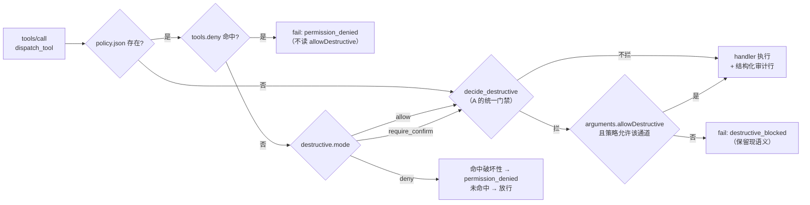

# ARC-P1-05 权限模型与破坏性门禁粒度设计方案

> **文档性质**：设计方案（**只设计，不含实现代码**）。本文件不改动任何既有代码与文档。
> **基线**：HEAD `e292770`（2026-10-17 晚；含工程师 ARC-P1-02 期望状态每工具一文件修复），全量回归 **201 passed**。文中所有 `file:line` 均在该提交上实测；若工作区存在未提交改动，以最终提交后的位置为准。
> **上游输入**：`docs/architecture_review_2026-10-16.md` §2 ARC-P1-05（仅作议题来源；本文所有证据一律本机重新实测，不引用他人结论作证据）。
> **相关既有机制**：P0 install 门禁（`4dc8b31`）、A12 子工具级破坏性（`_needs_destructive_confirm`）、P1-04 声明式注册表（`ee252eb`–`a2a8079`）、ARC-P1-02 期望状态拆分（`e292770`，与本方案无耦合）。

---

## 0. 结论摘要（TL;DR）

**推荐：方案 D = A（当期）+ C（次期），B 作为远期结构载体。**

一句话：先用 **A** 把「破坏性判定」从条目级下沉到子操作级、并收敛为**唯一门禁函数 + 唯一判定产物**（解决 Quicker 212 个动作一刀切拦截的可达性问题，默认行为零变更）；再用 **C** 的部署侧策略文件，把「哪些工具允许被调用 / 破坏性调用采取何种模式」从「客户端自己声明 `allowDestructive`」改为**服务端强制、客户端不可覆盖的部署策略**（解决最小信任）；**B** 的 spec 级 policy 注解与按会话授权，等出现多客户端/身份体系需求再上，其形态由 A 的判定产物自然演进而来。

| 方案 | 一句话 | 代价 | 解决什么 | 不解决什么 |
|---|---|---|---|---|
| A 最小增量 | 子操作级判定 + 统一门禁函数 | 小（~1 新模块 + 2 个 handler + schema 1 字段 + 文档） | G1 粒度不对称、G2 判定散落 | 信任假设 H1（客户端仍可自声明） |
| B 声明式 policy | spec 每条工具带权限注解，dispatch 统一拦截 | 中 | G2、G3（有声明位置） | H1（无身份时仍是静态策略） |
| C 配置级策略 | 部署侧 `policy.json`，客户端不可覆盖 | 中 | **H1 最小信任**、G3、G4 | 粒度不对称（需 A 打底） |
| **D = A + C（推荐）** | A 先落地，C 跟上 | 小 + 中 | G1–G4 全覆盖 | 多客户端/按会话授权（P3） |

---

## 1. 现状矩阵

### 1.1 工具全景（15 个 × 5 类，annotations 与门禁逐项实证）

> annotations 位置：`src/tool_specs.py` 各 `ServerToolSpec` 条目内；门禁位置：handlers。所有行号为 HEAD `e292770`。

| 类别 | 工具 | 自身 annotations（line） | 现行门禁 | 缺口 |
|---|---|---|---|---|
| **说明类** | `search_tools` | `readOnlyHint`+`destructiveHint:false`（`:371`） | 无（只读） | — |
| | `list_tools` | 同上（`:387`） | 无 | — |
| | `get_tool_info` | 同上（`:403`） | 无（但会对 mcp 类实时查后端状态，读操作） | — |
| | `launch_tool` | 同上（`:419`） | 无（**只返回命令、不执行**，`registry.launch_tool` 不 spawn） | — |
| **读取类** | `list_backend_tools` | `readOnlyHint`（`:468`） | 无 | — |
| | `get_backend_status` | `readOnlyHint`（`:515`） | 无 | — |
| | `get_backend_logs` | `readOnlyHint`（`:539`） | 无 | — |
| | `list_launcher_actions` | `readOnlyHint`（`:620`） | 无（只读缓存/重扫本地文件） | — |
| **启动类** | `start_backend` | `idempotentHint`（`:484`） | **间接**：触发 `ensure_installed()` → P0 install 双道门禁（见 §1.2.3） | 无「谁启动了什么」审计 |
| | `stop_backend` | `idempotentHint`（`:500`） | 无（杀掉任意后端进程） | 任何客户端可停任何后端 |
| | `sync_backend_tools` | `idempotentHint`（`:576`） | 无（写缓存） | — |
| | `sync_launcher_actions` | `idempotentHint`（`:592`） | 无（写缓存） | — |
| **执行类** | `call_backend_tool` | `openWorldHint`（`:448`） | **有**：`_needs_destructive_confirm(tool, sub_tool)`（`:102-120`），命中需 `allowDestructive`（`:224-233`）；结果带 `warning`（`:240-241`，判定同源复核在 `:240`） | 粒度只到「子工具名精确匹配」；授权是客户端自声明 |
| | `run_launcher_action` | `openWorldHint`（`:657`） | **有但粗**：仅条目级 `target_tool.get("destructive")`（`:329`），命中需 `allowDestructive`（`:330`） | **G1 粒度不对称**（见 §1.4） |
| **配置/控制类** | `set_backend_log_level` | `{}`（**不挂任何注解**，`:560`） | 无 | 控制操作无注解、无门禁 |
| **安装类**（非独立工具） | 嵌在 `start_backend` / 启动预热 | — | **有**：P0 双道门禁（§1.2.3） | 是**执行侧**约束，不是**授权模型**（无「哪些工具允许被安装」的上层策略） |

**类外事实**：`data/tools/*.json` 四份条目中当前只有两份标了 `destructive`——`quicker.json:21`（`destructive:true`，无 `destructiveTools`）与 `winget-mcp.json:18-19`（`destructive:true` + `destructiveTools:["install-winget-package"]`）；`everything.json:26` 为 `false`，`everything-search-mcp.json` 未标。

### 1.2 三类门禁机制现状

#### 1.2.1 annotations（咨询性，无强制力）

15 个工具的注解分布实测（`tool_specs.py`）：9 个 `readOnlyHint:true`、2 个 `openWorldHint:true`（两个执行类）、4 个 `idempotentHint:true`（启动类）、1 个 `{}`（`set_backend_log_level`，与 P1-04 等价搬迁时原样保留，`:560`）。

性质：MCP 协议中的 hints 是**服务端对客户端的建议**，协议不要求客户端据此限制调用；服务端自身也没有任何代码读取这些注解做拦截（全仓库 `grep` 证实：`capabilities` / `readOnly` 条目字段在 `src/` 内**零处读取**，是纯装饰字段——与 A2 修复前的 `destructive` 同病）。**注解≠门禁**。

#### 1.2.2 allowDestructive（客户端自声明，现唯一「授权」通道）

- 后端：`tool_specs.py:102-120` 判定规则——条目未标 `destructive` → 不拦；标了且无 `destructiveTools` → 整后端拦；标了且有清单 → 只拦清单内子工具（精确匹配 `sub_tool in listed`）。
- 启动器：`tool_specs.py:329-337` 仅判**条目级** `destructive`，与动作无关。
- 授权方式：调用方在 `tools/call` 的 `arguments` 里传 `allowDestructive=true`（inputSchema 声明于 `tool_specs.py:440` 与 `:649`）。
- 拒绝产物：`errorType="destructive_blocked"`（`errors.py:52`），消息见 `tool_specs.py:228` / `:333`。

#### 1.2.3 install 双道门禁（执行侧，P0 `4dc8b31`）

| 层 | 位置（HEAD 实测） | 内容 |
|---|---|---|
| 授权 | `backend_client.py:85` 起 `install_auto_authorized_by_env()`（env 读取在 `:92`）；`:393` 起 `_install_authorized()` | 环境变量 `AWAM_AUTO_INSTALL=1` 或条目 `install.auto is True`（`schema.py:120` 起），任一即可；默认都关 |
| 白名单 | `backend_client.py:226` `INSTALL_COMMAND_ALLOWLIST`（环境变量名常量 `:222`）；`:412` 起 `_install_command_allowed()` | 无 shell 元字符 + 前缀命中 `npm i -g` / `pnpm add -g` / `yarn global add` 等，且前缀后有包名 |
| 执行点 | `backend_client.py:445` 起 `ensure_installed()`：未授权分支 `:516-527`（`installBlocked:"unauthorized"` 在 `:526`）、白名单分支 `:533-543`（`"not_allowed"` 在 `:541`） | 未授权返回 `installBlocked:"unauthorized"`；白名单不过返回 `"not_allowed"`；对应 errorType `install_required` / `install_not_allowed`（`errors.py:59-60`） |

性质：这是**命令能否被执行**的约束（防本地 RCE），**不是**「哪个调用者/哪次会话被允许触发安装」的授权模型——它不区分调用来源，也没有「只允许为 X 工具安装、不允许为 Y 工具安装」的上层策略。

### 1.3 隐含信任假设（本方案要显式化处理的核心）

| # | 假设 | 证据 | 后果 |
|---|---|---|---|
| **H1** | **客户端可自行声明 `confirm` 即视为授权** | `allowDestructive` 是 `arguments` 里的普通布尔（`tool_specs.py:225`/`:330`），服务端不校验来源 | AI 客户端（或任何能发 `tools/call` 的进程）可以自己传 `allowDestructive=true` 绕过门禁。「人工确认」完全依赖**网关/客户端 UI 是否真的插入了一步确认**——服务端无从知晓，也无法强制 |
| **H2** | 单用户本地进程，无调用者身份/会话 | MCP stdio 单进程模型；`ToolContext`（`tool_specs.py:39-53`，`frozen=True`）只注入 manager，无身份/会话字段 | 无法表达「某客户端只允许只读子集」（评审建议的能力授权落不了地——没有主语） |
| **H3** | 无审计 | 破坏性放行只 `ctx.log(...)` 一行到 stderr（`tool_specs.py:233`/`:337`），无结构化字段、无落盘 | 「谁批准了什么」不可追溯；事后无法复盘误放行 |

### 1.4 缺口清单

| # | 缺口 | 实证 | 影响 |
|---|---|---|---|
| **G1** | 启动器判定粒度不对称：条目级 `destructive:true` → **全部 212 个动作**（本机运行时缓存实测：`%LOCALAPPDATA%/.awam-tool-manager/launcher-actions/quicker.json`，`source=partial`，212 条）每一次 `run_launcher_action` 都要 `allowDestructive`，含纯查询/发送按键类动作 | `tool_specs.py:329`；`data/tools/quicker.json:21` | **可用性损失**：要么每次调用都传 `allowDestructive`（等于永久免确认），要么不能用；「确认」退化为噪声 |
| **G2** | 判定逻辑散落两处、语义不一致（后端子工具精确匹配 vs 启动器条目级），未来加执行类工具还会再抄一遍 | `tool_specs.py:102-120` vs `:329-337` | 维护点扩散；新工具漏接门禁不会被任何测试自动发现 |
| **G3** | 授权是**客户端自声明**（H1）：`allowDestructive=true` 之后**对整条命令放行**，无按动作/按子工具的细粒度授权、无「本会话只允许 X」 | `tool_specs.py:225`/`:330` | 一次确认覆盖后续所有调用；最小权限无从表达 |
| **G4** | **无部署侧策略**：无法表达「这台机器上，这个网关托管的 AI 只允许只读工具 / 破坏性一律拒绝 / 某工具禁用」 | 全仓库无配置文件读取（仅 env：`AWAM_RUNTIME_DIR` `runtime_paths.py:42`、`AWAM_AUTO_INSTALL` 常量定义 `backend_client.py:222`） | 最小信任做不到——策略只能写在 AI 的提示词里（不可信） |
| **G5** | 启动器动作无破坏性元数据：动作结构只有 `{id, name, type, app, description}`（`launcher_client.py:139-145`；运行时缓存实测 212 条同构），无任何 destructive 字段 | 实测 | 即使想做动作级判定，也**没有数据来源**——只能靠部署者配置（这决定了方案 A 的形态，见 §2.1） |
| **G6** | `set_backend_log_level` 无任何注解（`annotations={}`）也无门禁，是 15 个工具里唯一的「三无」控制操作 | `tool_specs.py:560` | 语义不透明（客户端无法判断读写性）；P1-04 等价搬迁原样保留，属已知遗留 |
| **G7** | 条目字段 `readOnly` / `capabilities` 无消费方（纯装饰） | `src/` 内零处读取（schema 之外） | 数据文件「看起来」在表达权限，实际不生效——比不写更危险（虚假安全感） |
| **G8** | 破坏性拒绝/放行无结构化审计 | `tool_specs.py:233`/`:337` 仅自由文本 | 见 H3 |

---

## 2. 方案选项

### 2.1 方案 A：最小增量——子操作级判定 + 统一门禁函数

**机制**

1. 抽**唯一门禁函数**（建议新模块 `src/policy.py`，为 C 阶段演进留位）：

   ```python
   # 概念接口（非实现代码）
   def decide_destructive(kind: str, tool: dict | None, sub_op: dict, args: dict) -> Decision
   # Decision = {"blocked": bool, "reason": str, "audit": {...}}
   ```

   判定表（**默认全部保持现行为**）：

   | kind | 规则（自上而下） |
   |---|---|
   | mcp | 条目未标 `destructive` → 放行；有 `destructiveTools` → 子工具精确匹配才拦（现语义）；无清单 → 整后端拦（现语义） |
   | launcher | 条目未标 `destructive` → 放行；有 **`destructiveActions`**（新增字段）→ 按动作 `id`/`name`/`type` 做大小写不敏感 glob 匹配，命中才拦；**无该字段 → 回退条目级全拦（现语义，不回退）** |

2. `_handle_call_backend_tool`（`:215` 起）与 `_handle_run_launcher_action`（`:324` 起）改为调用统一函数；拒绝消息里带上「命中的具体子操作」。
3. **审计**：每次判定（放行/拒绝）产出一行结构化 stderr 日志：`ts / tool / kind / sub_op / decision / rule_hit / client_declared`（`client_declared` 明确记录「授权来自客户端参数」这一事实，为 C 阶段对比用）。
4. `schema.py` 新增 `destructiveActions` 字段（`type: array, items: string`，glob 语义；格式与 `destructiveTools` 并列），`docs/format.md` 生成块随之自动更新（`scripts/generate_format_doc.py`）。
5. `data/tools/quicker.json` **不启用**该字段（默认行为零变更；启用属部署决策，模板见附录 A）。

**改动面（预估）**：新 `src/policy.py`（~120 行）+ `tool_specs.py` 两 handler 各 -10/+6 行 + `schema.py` +8 行 + `SKILL.md` 两行契约文案 + `docs/format.md`（生成）+ 新测试文件 `tests/test_policy_gate.py`（~15 用例）+ `tests/test_launcher_client.py` 补动作级用例。

**代价**：小。**风险**：低——默认分支逐条复用现有语义（等价性可像 P1-04 一样用 golden/对照测试锁住）。

**兼容性**：完全向后兼容（无 `destructiveActions` = 现行为）。

**golden 与契约影响**：`tools/list` 输出**不变**（annotations 与 inputSchema 均不动）→ `tests/golden/tools_list.json` 不动；`SKILL.md:79` 的 `run_launcher_action` 行与 `docs/format.md` 对外契约表对应行需补「配 `destructiveActions` 时按动作级判定」；`schema.py` 新增字段是 `format.md` **生成块**，跑生成器即可（`tests/test_docs_sync.py` 守卫自动兜底）。

**行为变更点**：**仅在条目配置了 `destructiveActions` 之后**发生（未匹配的动作从「拦」变「放」）——属安全属性**放宽**，必须按行为变更申报，且要求显式配置才生效。

**不解决**：H1（客户端仍可自声明 `allowDestructive` 放行命中的动作）。——这是 C 的职责。

### 2.2 方案 B：声明式 policy（spec 级权限注解 + dispatch 统一拦截）

**机制**

1. `ServerToolSpec` 增加 `policy: Policy | None` 字段（`tool_specs.py:56-76` 的 dataclass 第 7 个字段）：`level ∈ {"read", "control", "execute", "install"}`、`requires_confirmation: bool`、`audit: bool`。
2. 15 条 spec 逐一标注（这同时补上 G6：`set_backend_log_level` 获得 `level="control"`）。
3. **单一拦截点**：`server.dispatch_tool`（`server.py:153-163`，P1-04 后的唯一 choke point）在 `spec.handler(...)` 前统一执行 `policy.check(name, arguments)`——新增工具漏接门禁由 `validate_specs()`（`tool_specs.py:696` 起）在 import 期强制。
4. policy 不进 `list_tools` 输出（保持 golden 不变），只作内部判定。

**改动面**：`tool_specs.py`（dataclass + 15 条标注 + validate_specs 增强）、`server.py`（dispatch +10 行）、测试（引入「每个 spec 必须有 policy」的完整性守卫）。

**代价**：中（一次全表标注 + 守卫测试）。**风险**：中——15 条逐一标注有抄错空间，但 completeness 守卫可兜。

**兼容性**：行为不变（默认 `requires_confirmation` 值按现语义映射）。**golden**：不受影响（policy 不下发）。**契约**：SKILL.md 无需变（工具行为不变）。

**不解决**：H1。没有调用者身份，「policy」只是更整齐的静态判定——与 A 的判定产物同权，但比 A 多解决 G2/G6。

**结论**：B 是 A 的「正交升级」而不是替代——A 的判定函数可以**整体成为** B 的 `policy.check` 内核。先做 B 也要先有 A 的判定逻辑，否则 15 条标注没有消费者。故 B 排在 D 的第三阶段（见 §3.3）。

### 2.3 方案 C：配置级策略（部署侧 `policy.json`，最小信任）

**机制**

1. 新增策略文件（建议仓库内 `data/policy.json`，随部署分发；`AWAM_POLICY_FILE` 环境变量可覆盖路径）＋ `schema.py` 校验（照 `TOOL_ENTRY_SCHEMA` 的两层模式）：

   ```json
   {
     "version": 1,
     "tools": { "deny": ["stop_backend"], "allow": null },
     "destructive": { "mode": "require_confirm" },
     "audit": { "destructive": true }
   }
   ```

   - `tools.allow = null` 表示不启用白名单；`tools.deny` 命中即拒绝（deny 优先于 allow）。
   - `destructive.mode ∈ {"deny", "require_confirm", "allow"}`：**deny** = 任何命中破坏性判定的调用直接拒绝（网关只读部署）；**require_confirm** = 现行为（默认）；**allow** = 部署者声明本机信任，跳过确认（须显式写）。
2. **执行点 = 同一 choke point**（`dispatch`）：先 `policy.check_call(name)`（deny/allow），再进 handler 内的 `decide_destructive`（A 的产物），最后才看客户端 `allowDestructive`。
   - **关键差异**：`mode="deny"` 时**不读** `allowDestructive`——客户端声明与策略冲突时**策略赢**。这是 H1 的正面回应。
3. `policy.json` 缺失 → 全部走现状（零配置零变更）。
4. 审计：C 阶段起把 A 的结构化审计行**落盘**（`<runtime>/audit.log`，append，含 policy 版本/命中规则）。
5. 新 errorType：`permission_denied`（`errors.py` 枚举 16→17）——语义「被部署策略拒绝，不可重试，需管理员改 `policy.json`」；与 `destructive_blocked`（客户端可自解）区分。**此项需拍板**（见 §5 Q3）。

**改动面**：新 `src/policy.py` 扩展（+80 行）+ `schema.py`（+40 行 schema）+ 启动期加载（`server.py` 或 `policy.py` 内 import 期，照 P1-04 的快速失败先例）+ `errors.py` +1 枚举 + SKILL.md/format.md 契约同步 + 守卫测试。

**代价**：中。**风险**：中低——默认无文件即现状；风险集中在「策略语义边界」（如 deny 与 require_confirm 叠加）。

**兼容性**：向后兼容（无文件 = 现状）。**golden/契约**：工具输出不变；`permission_denied` 进 errorType 契约（SKILL.md `:102` 行、format.md 枚举、`tests/test_error_type_contract.py` 三方守卫——P1-03 建的机制正好接住）。

**行为变更点**：仅在存在 `policy.json` 且内容非默认时发生；`destructive.mode="deny"` 是**收紧**（安全方向），`"allow"` 是**放宽**（须显式）。

### 2.4 方案 D：A + C 组合（推荐）

A 解决「能不能细」（G1/G2），C 解决「谁说了算」（H1/G3/G4）。两者共享同一个 `src/policy.py` 与同一个 dispatch choke point，A 是 C 的内核，C 是 A 的策略源。分两期落地，每期都是独立可交付、可回归的小步。

---

## 3. 推荐方案（D）与分阶段实施

### 3.1 Phase 1（方案 A，建议定 P2，一个小任务）

1. 新建 `src/policy.py`：`decide_destructive(kind, tool, sub_op, args) -> Decision`，判定表按 §2.1；判定结果含 `reason` 与 `audit` 字段。
2. `tool_specs.py`：两个执行类 handler 改用统一函数；删除原地条件判断；拒绝消息带具体子操作。
3. `schema.py`：新增 `destructiveActions`（array[str]，glob）；`scripts/generate_format_doc.py` 跑一遍更新 `docs/format.md` 生成块。
4. `SKILL.md:79` / `docs/format.md` 契约表：`run_launcher_action` 行补动作级语义；`SKILL.md:128-131`（安全约定段）补 `destructiveActions` 说明。
5. 测试与守卫：
   - `tests/test_policy_gate.py`：判定表逐行（5 类规则 × 拦/放 × 边界）、glob 匹配（id/name/type、大小写）、**等价性**（无新字段时与旧行为逐字一致——照 P1-04 golden 思路采对照）；
   - `tests/test_launcher_client.py` 补：配 `destructiveActions` 后未命中动作可执行、命中动作仍拦；
   - 审计行格式断言（decision/rule_hit/client_declared 三字段）。
6. **golden**：`tools_list.json` 不动；如实现中动了 annotations 视为越界（应 zero diff）。
7. **行为变更申报**：提交信息显式声明「`destructiveActions` 为新增可选字段；未配置时行为与当前逐字等价；配置后未匹配动作由拦转放（安全放宽，需部署者显式启用）」。

### 3.2 Phase 2（方案 C，建议 P2/P3，依赖 Phase 1）

1. `schema.py` 新增 `POLICY_SCHEMA`（`tools.allow/deny`、`destructive.mode`、`audit`）；`policy.py` 增加 `load_policy()`（`AWAM_POLICY_FILE` 覆盖，import 期解析失败**快速失败**——照 P1-04 `validate_specs()` 先例，坏策略不能带病运行）。
2. `server.dispatch_tool`（`server.py:153-163`）前置 `policy.check_call(name)`；`mode="deny"` 时不读 `allowDestructive`。
3. 新 errorType `permission_denied`（若 Q3 拍板通过）：`errors.py` + SKILL.md 枚举 + format.md + `tests/test_error_type_contract.py` 站点台账同步。
4. 审计落盘：`<runtime>/audit.log`（复用 `runtime_paths.get_runtime_dir()`）。
5. 测试：`tests/test_policy_config.py`（schema 校验、deny 优先、deny 覆盖客户端声明——**这是 H1 的验收测试**、坏文件快速失败、无文件零变更）；`test_docs_sync.py` 策略文件若进生成体系则同步守卫。
6. **行为变更申报**：`policy.json` 不存在 = 零变更；存在且非默认时按内容申报（deny 属收紧、destructive.allow 属放宽）。

### 3.3 Phase 3（方案 B，仅列触发条件，不排期）

触发条件（任一）：①出现第二个并发客户端/网关实例需要按实例区分权限；②需要「按会话临时授权」（届时才引入会话标识与 capability grant——注意仍非用户身份体系）；③执行类工具从 2 个变成 5+ 个，散落判定再次失控。进入条件满足时，A 的 `decide_destructive` 内核直接迁入 spec 级 `policy` 字段，dispatch 拦截点不动。

### 3.4 判定流水线（Phase 2 完成后的单次调用）



> 注：`mode="deny"` 时 `allowDestructive` 通道被策略短路——客户端声明与部署策略冲突时策略赢（H1 的修复点）。

---

## 4. Scope 边界（本期明确不做）

1. **不引入用户身份/认证体系**，不做会话概念（H2 是设计前提，不是本方案要解决的缺陷；MCP stdio 单用户本地进程）。
2. **不改网关协议**（toolport 托管 stdio 的接入方式不变），不新增 `tools/call` 入参字段（沿用 `allowDestructive`）。
3. **不做交互式确认 UI**——「是否插入人工确认步」仍是调用方/网关的职责，本方案只保证**策略不可被客户端覆盖**。
4. **不迁移 `data/` 目录结构**，不改 `data/tools/*.json` 的现有字段语义（`destructive`/`destructiveTools` 原样有效）。
5. **不动 `tools/list` 下发内容**——annotations 与 inputSchema 冻结（golden 保护）；`policy`/`destructiveActions` 均不改变既有字段。
6. **不为 Quicker 212 个动作做启发式破坏性推断**（G5：动作数据无此元数据，按 `type`/名称猜分类不可靠且方向危险）；只提供模式配置 + 文档模板。
7. **不重做 install 门禁**（P0 已解决执行侧）；C 只在其上加「哪些工具允许被安装」的上层策略预留位，首版不启用。
8. **不做审计查询接口**（只落盘 append；查询/轮转超出本期）。

---

## 5. 待裁决问题

| # | 问题 | 我的建议 | 影响面 |
|---|---|---|---|
| **Q1** | 启动器动作级判定用 `destructiveActions` **glob 模式**（匹配 id/name/type，大小写不敏感）+ 缺省回退条目级，是否接受？要不要同时支持精确 id（`=` 前缀）？ | 接受 glob 单机制（`fnmatch` 对 212 条一次线性匹配开销可忽略）；**不做** `=` 前缀特例（降低规则表达力=减少误配面）；附录 A 给模板 | 方案 A 的核心形态 |
| **Q2** | `policy.json` 放哪：仓库 `data/policy.json`（随部署分发、可评审）vs 运行时目录（每机独立、不入库）？ | **仓库 `data/policy.json`** + `AWAM_POLICY_FILE` 覆盖 + schema 校验入库；理由：策略是「部署意图」，应可评审、可版本化；机私覆盖走环境变量 | 方案 C 落地形态 |
| **Q3** | 新增 errorType `permission_denied`（16→17）还是复用 `destructive_blocked`？ | **新增**。语义不同：`destructive_blocked` 客户端可自解（传 allowDestructive），`permission_denied` 客户端无解（需改 `policy.json`）——混用会让客户端无法区分「换个请求就能过」与「怎么试都不过」。代价：SKILL.md/format.md/守卫三处同步（P1-03 机制已覆盖） | 契约变更，需拍板 |
| **Q4** | 审计落点：Phase 1 只 stderr 结构化行，Phase 2 加 `audit.log` 文件 sink——够吗？ | 够。文件 sink append-only、不轮转（首版），避免过度工程 | 方案 A/C 交付物 |
| **Q5** | `destructive.mode` 默认 `require_confirm`（现状）确认？`allow` 模式是否保留？ | 默认 `require_confirm`；保留 `allow`（显式信任声明有真实场景：本机自用）但要求在 `policy.json` 里显式写 | 方案 C 语义 |
| **Q6** | Phase 1 是否顺带修 G6（`set_backend_log_level` 补 `idempotentHint:true`）？ | **不**。会改 `tools/list` 输出（golden 变），属独立行为变更，建议并入后续「annotations 修正」小批次，不与权限模型混做 | 范围控制 |

---

## 附录 A：Quicker 动作数据实测与 `destructiveActions` 模板

- 本机运行时缓存实测（2026-10-17，`%LOCALAPPDATA%/.awam-tool-manager/launcher-actions/quicker.json`）：`source=partial`，**212 条**，每条字段 `{id, name, type, app, description}`——**无破坏性元数据**（G5 的直接证据）。采样：`{"name":"->右","type":"SendKeys"}`、`{"name":"AWAM图片点击工具","type":"XAction"}`。
- `destructiveActions` 模板（**仅文档建议，不入库、不默认启用**；启用前必须人工核对）：

  ```json
  "destructiveActions": ["*卸载*", "*删除*", "*清理*", "*格式化*", "uninstall*", "remove*", "*install*"]
  ```

  说明：glob 语义下匹配 `id`/`name`/`type` 三者任一；`source=partial` 时大量动作只有 ID 没有名称，**名称类模式对它们不生效**——这正是「默认不启用、由部署者按实际动作清单核对后配置」的原因（partial 数据上做安全默认会两头不讨好：宁可漏拦也不能误放）。

---

## 附录 B：与既有裁决/机制的关系

| 既有事项 | 关系 |
|---|---|
| A2（`destructive` 从装饰字段变为门禁）/ A12（子工具级） | 本方案的 Phase 1 是其自然延伸：判定产物收敛、粒度补齐启动器侧 |
| P0 install 门禁（`4dc8b31`） | 保留不动；C 不重做白名单，只预留「允许安装的工具集合」上层位 |
| P1-04 声明式注册表 | 提供 dispatch 唯一 choke point（`server.py:153-163`）与 import 期快速失败先例——B/C 都挂在这里 |
| P1-03 errorType 契约（16 种） | Q3 若通过则扩至 17 种，按 P1-03 的契约化与守卫机制同步 |
| `TASKS.md:305`「P3 - 权限控制（哪些工具 AI 可以直接执行）」 | 本方案即其落地设计；建议在该条下引用本文件 |
