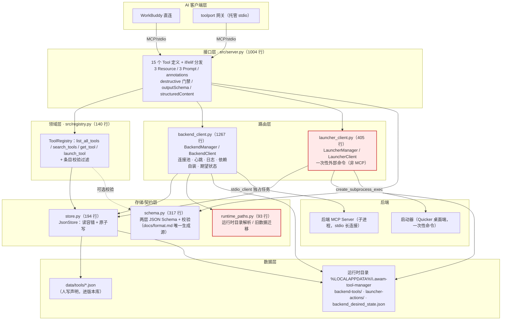
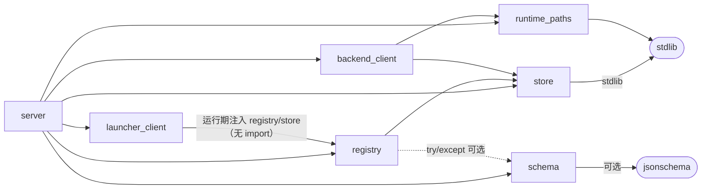
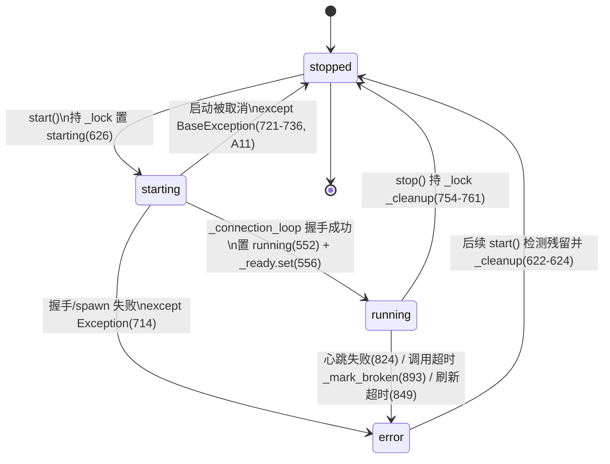

# awam-tool-manager 架构与设计原理评审报告

> 评审对象：`G:/Projects/19AI/skills/awam-tool-manager`
> **快照**：正文基线为评审时工作区（A13 之后、A14 之前）；**§3 漂移表与全部 file:line 已复核至 HEAD `c40d80d`（A14）**。
> 评审日期：2026-10-16 / 复核日期：2026-10-16（HEAD `c40d80d`）
>
> **后续修订（2026-10-17）**：HEAD 已推进至 `4dc8b31`（P0 修复）与 `4edead9`（chore）。
> **ARC-P0-01 已由 `4dc8b31` 修复**——install 自装命令执行加授权门禁（`AWAM_AUTO_INSTALL=1` 或条目 `install.auto=true`）与命令白名单，未授权时预热退化为纯检测、`start_backend` 返回 `install_required` 且不 spawn 子进程。该条**保留 P0 定级留档**（定级反映修复前的风险），其余 17 条维持原定级。
> 本报告其余正文为 `c40d80d` 基线的静态评审结论，未逐条重锚至 `4edead9`；引用 `server.py` 行号者注意 P0 修复后已漂移（另见 §3.1 的 driver 漂移项）。
> **二次修订（2026-10-17，P1-04 重构 M00–M08 落地后）**：`server.py` 1020 → 464 行，新增 `src/errors.py` / `src/tool_specs.py`，正文全部 `server.py` 行号再次失效。**重锚不逐条改写正文**——新增 **§0「P1-04 重构后的基线声明与锚点映射」**：含旧→新锚点映射表、P1-04 对各发现项的影响（ARC-P1-04 已修复、ARC-P1-05 维持、TOP-5 第 4 位已完成）、评级口径说明。引用行号前请先查 §0.1。
> 评审范围：分层与职责、依赖方向、单一真相源、可扩展性、并发与生命周期、错误语义、进程资源管理、安全边界、数据存储、可测性与可观测性
> 方法：静态阅读全部 `src/` 源码、`tests/`、`data/`、`scripts/` 与全部文档；逐条到代码核实主持人在文档中发现的可疑漂移；**未运行任何测试或程序**。
> 去重说明：`docs/code-review.md` 中标记「✅ 已修复」的 D1–D26 / A1–A13 **不重复列举**，仅在 §3 漂移表内以「历史已修复但文档未同步」一笔带过。
>
> **评审期间的并发变更（重要）**：本报告首次成稿后，仓库合入 `c40d80d`（feat: A14——运行时数据迁到 `%LOCALAPPDATA%`），该提交**同时重写了 `README.md` / `SKILL.md` / `TASKS.md` / `docs/{architecture,format,mcp-conformance,code-review}.md`，并把本报告的初稿一并提交入库**。因此：
> - 原初稿中的若干漂移**已被 A14 顺带修好**——这些不再计入「现存缺陷」，统一移入 **§3.2「评审后已修复（留底）」**；
> - §3.1 只列 **复核 HEAD `c40d80d` 后仍存在**的漂移；
> - P0/P1/P2/P3 各条已按 HEAD 重核证据行号，无实质结论变化。
> 证据纪律：本报告严格区分「已确认事实（附 file:line）」与「推断/建议」。凡无 file:line 支撑者，一律标注为「推断」。

---

## 0. P1-04 重构后的基线声明与锚点映射（2026-10-17，任务 #8）

**本报告正文的全部 file:line 引用均基于评审时点代码**（`server.py` 1020 行版本，HEAD `c40d80d`~`4edead9`）。2026-10-17 的 **P1-04 声明式注册表重构**（commits `ee252eb`–`a2a8079`，M00–M08 全量回归 192 passed）已改变引用地图：`server.py` 降至 **464 行**，新增 `src/errors.py`（35 行）与 `src/tool_specs.py`（728 行）。按下表换算行号；**不逐条改写正文**（正文是评审时点的历史记录，按「定级留档」原则保留）。

### 0.1 锚点映射表（旧 → 新，新锚点截至 HEAD `a2a8079`）

| 本报告引用（旧，`server.py`） | P1-04 后位置 |
|---|---|
| `:41` `import JsonStore` | `server.py:36`（未动） |
| `:57-58` manager 实例化 | `server.py:67-68`（未动） |
| `:73-91` `TOOL_ANNOTATION_HINTS` | **已删除**；annotations 逐条内联至 `tool_specs.py:351-657` `SERVER_TOOL_SPECS` |
| `:100-105` `SHARED_OUTPUT_SCHEMA` | `tool_specs.py:79-91`（含 outputSchema↔structuredContent 约束注释原文） |
| `:108-126` `_needs_destructive_confirm` | `tool_specs.py:102-120` |
| `:132-136` `call_tool` 的 `except ToolError` | `server.py:130-137`（该函数逐字未动） |
| `:147-151` `ensure_success` / `fail` | `errors.py:31` / `errors.py:24`；`server.py:45` re-export（同一对象） |
| `:158-431` 15 个 `Tool(...)` 字面量 | `tool_specs.py:351-657` `SERVER_TOOL_SPECS`（15 条 spec） |
| `:171`/`:185` `kind` 的 driver 文案 | `tool_specs.py:365`/`:381`（NE-5：原文保留，本期不许修，见 §3.1 第 20 条） |
| `:205-206` `launch_tool` 描述 | `tool_specs.py:407` |
| `:303-324` `get_backend_logs` Tool 定义 | `tool_specs.py:516-537` |
| `:489-493` structuredContent 返回 | `server.py:146-150`（逐字未动） |
| `:500-717` `dispatch_tool` if/elif 链 | `server.py:153-163` 查表分发 + `tool_specs.py:123-347` 15 个 handler |
| `:501` `arguments.get("keyword","")` | `tool_specs.py:124` |
| `:577-580` `launch_tool` 分支 | `tool_specs.py:203-206` |
| `:591` `call_backend_tool` destructive 门禁 | `tool_specs.py:224-232` |
| `:622` `start_backend` 包装 | `tool_specs.py:254-258` |
| `:674` `launcher_error` | `tool_specs.py:310` |
| `:677` `store.load_launcher_catalog` | `tool_specs.py:313` |
| `:696` `run_launcher_action` 条目级判定 | `tool_specs.py:329-336` |
| `:890` `unknown_prompt` | `server.py:334`（未动） |
| `:914` `ensure_all_installed` 调用 | `server.py:363`（未动） |
| `:954-996` `main()` stdio 段 | `server.py:442-453`（未动） |
| `:978`/`:980` 预热/恢复任务创建 | `server.py:438`/`:440`（未动） |

### 0.2 P1-04 对本报告发现项的影响

| 发现项 | P1-04 后状态 |
|---|---|
| **ARC-P1-04**（`server.py` 三个平行维护点 / 真相源并行） | ✅ **已修复**。真相源收敛为 `tool_specs.py` 单条 `ServerToolSpec` 记录（annotations 与工具名同生共死）；一致性由 golden 五字段比对 + 三方名字守卫 + `validate_specs()` import 期自检**强制保证**。新增对外工具的维护点从 9 处降为 1 文件 2 代码块。**子项「inputSchema 运行期参数校验」仍未做**——本期设计决策（缺参走 not_found 是既有行为，只加结构守卫），该子项维持原状 |
| 「成功/错误包装在每个分支各自重写」（ARC-P1-04 证据） | ✅ **已修复**。序列化收敛到 `server.py:163` 一处 |
| **ARC-P1-05**（launcher 只有条目级破坏性） | **维持原判**。`run_launcher_action` 仍只判条目级 `destructive`（`tool_specs.py:329`）；P1-04 按行为等价硬约束原样保留，门禁粒度未扩未缩 |
| TOP-5 第 4 位「server.py 声明式工具注册表」 | ✅ **已完成**（即 P1-04 本体，M00–M08） |
| 其余 P0/P1/P2/P3 条目 | 结论不变；证据行号按 §0.1 换算 |

### 0.3 评级口径

分维度评级与 ARC-P0-01 一样按「定级留档」原则描述评审时点。若按 P1-04 后状态重估受影响维度：「单一真相源」C → 工具清单面已收敛（9 处 → 1 处 spec + 1 处 SKILL.md 手写副本，后者有漂移守卫），但「可执行配置进版本库」「errorType 契约只落实 1 处」（ARC-P1-03，P1-03 立项中）等根因仍在；「可扩展性（server.py）」C+ → 新增工具成本已从 ~5 处代码 + 4 处文档降为 1 文件 2 代码块。完整重评待 P1-03 落地后一并做。

---

## 1. 总体结论

**一句话**：这是一个**职责分层正确、工程细节扎实（原子写、anyio 取消作用域、错误兜底都做对了）但「单一真相源」承诺只兑现了一半、并把后端生命周期归属放错位置后用持久化文件补偿**的本地工具聚合层；代码质量明显高于文档质量。

**架构成熟度评级：C+（可用、局部优秀，但存在 1 项安全级缺陷 + 生命周期归属与 SSOT 两项结构性缺陷）。**

> **修订（2026-10-17）**：上述唯一 P0 安全缺陷（ARC-P0-01）已由 commit `4dc8b31` 修复并通过 183 passed 回归。按「定级留档」原则本评级不回溯修改——C+ 描述的是评审时点的风险面；若按修复后状态重评，安全边界一项可由 D 升至 C-（门禁与白名单已就位，但「可执行配置进版本库」这一根因仍未在 schema 层显式分区，见 ARC-P2 相关建议）。

分维度速览：

| 维度 | 评级 | 一句话 |
|---|---|---|
| 分层与职责边界 | B- | 六模块分层清晰、无循环依赖，但 `server.py` 跨层直取 `store`、`registry` 混入校验 |
| 依赖方向 | A- | 严格单向「向下」，无循环；但「schema→format.md→data」三方一致只对字段表成立 |
| 单一真相源 | C | 工具清单散落 **9 处**；仅 `format.md` 字段表有防漂移机制 |
| 可扩展性（server.py） | C+ | 已到声明式注册表的临界点：新增一个工具要动 ~5 处代码/测试 + 4 处文档 |
| 并发与生命周期 | B | 三把锁 + 独占连接任务设计自洽；但 status 由 5+ 任务无锁写入 |
| 错误语义 | C+ | `errorType` 契约只有 1 个函数真正落地，其余失败路径静默漏字段 |
| 进程/资源管理 | D+ | A10 是「生命周期归属放错后拿文件补偿」的补丁（详见 ARC-P1-01） |
| 安全边界 | D | `install.command` 启动即执行任意命令、无门禁（详见 ARC-P0-01）——**已由 `4dc8b31` 修复，定级留档；修复后约 C-** |
| 数据与存储 | B- | 「JSON 即库」小规模可接受，但期望状态文件的跨实例读改写有竞态 |
| 可测性与可观测性 | C | 全用替身测试、无真实端到端；日志只有自定义工具、无标准 logging capability |

**最致命的一条（ARC-P0-01）**：`data/tools/*.json` 里的 `install.command` 会在**服务启动时被后台无条件执行**（`server.py:914` → `backend_client.py:436`），该命令来源是**进版本库的数据文件**，且**不受任何 `destructive` / `allowDestructive` 门禁约束**。这与「`launch_tool` 只返回命令、绝不执行」的取舍方向完全相反，构成最小权限倒置与本地 RCE 面。

> **✅ 已修复（commit `4dc8b31`，2026-10-17 确认）**：安装执行已加双重门禁——授权来源为环境变量 `AWAM_AUTO_INSTALL=1` 或条目 `install.auto=true`（任一），授权后还须通过命令白名单（不含 shell 元字符、前缀属于 `npm i -g` / `winget install` / `pip install` 等受支持形式）。未授权时服务启动预热**退化为纯检测**（只在 stderr 报告缺什么，不执行任何外部命令），`start_backend` 返回 `install_required` 且不 spawn 子进程；授权但不合法时返回 `install_not_allowed`。修复后回归 **183 passed**。**本条 P0 定级保留留档**，因其反映的是修复前的风险面与「最小权限倒置」这一设计教训；根因「可执行配置进版本库、未在 schema 层与人写展示字段显式分区」仍未消除，相关建议（见下方第 3 条与 ARC-P2 的安全边界建议）继续有效。

---

## 2. 问题清单

> 分级：P0 阻断 / P1 结构性缺陷 / P2 一致性与可维护性 / P3 改进建议。

### P0 —— 阻断级（1 条）

> **状态修订（2026-10-17）**：本级唯一条目 ARC-P0-01 **已由 commit `4dc8b31` 修复**（183 passed）。按 team-lead 裁决，**P0 定级保留留档**，条目正文按评审时点原样保留，仅在下方追加修复说明。

#### ARC-P0-01　`install.command` 在服务启动时被无条件自动执行，且无任何门禁

> **✅ 已修复（`4dc8b31`）**：执行前置显式授权（`AWAM_AUTO_INSTALL=1` 或条目 `install.auto=true`，任一即可）+ 命令白名单（拒 shell 元字符与非法前缀）；未授权时预热纯检测、`start_backend` 返回 `install_required` 不 spawn 子进程。**P0 定级留档。** 下方证据与影响描述的是修复前状态，作为设计教训保留。

- **证据**：
  - 服务启动即后台预热：`server.py:978` 创建 `_prewarm_backends()` 任务 → `server.py:914` `backend_manager.ensure_all_installed()` → `backend_client.py:1114` `client.ensure_installed()`。
  - 真正执行任意 shell：`backend_client.py:436` `asyncio.create_subprocess_shell(install_command)`；`install_command` 直接取自 `data/tools/*.json` 的 `install.command`（`backend_client.py:325-331`）。
  - 无门禁：该路径不经过 `_needs_destructive_confirm`（`server.py:108-126`），不检查 `destructive`，也不需要 `allowDestructive`。
  - 对照取舍：`launch_tool` 描述为「只返回命令，不实际执行启动」（`server.py:206`），而其命令来源同样是 `data/tools/*.json` 的 `launch.command`。
  - 命令载体进版本库：`git ls-files data/` 输出 `data/tools/{everything,everything-search-mcp,quicker,winget-mcp}.json` 均被跟踪。
- **影响**：
  1. **最小权限倒置**：副作用更小（仅返回文本）的 launch 命令不执行；副作用更大（任意 shell）的 install 命令却被自动执行。
  2. **本地 RCE 面**：任何能改动仓库（或提交一个恶意工具条目）的人，可在每个运行本服务的机器上、**服务启动瞬间**执行任意命令，无需任何调用方确认。CI/共享主机场景下即为阻断。
- **建议**（任一即可，建议 1+2）：
  1. 给 install 执行加显式开关（环境变量 `AWAM_ALLOW_INSTALL=1` 或每条目的 `install.autoApprove=true`），默认**不自动执行**，启动预热默认只检测不安装；
  2. 启动预热与 `start_backend` 前置安装都应落到「确认门禁」之下，与 `destructive` 同级；
  3. 文档明确标注 `data/tools/*.json` 为**代码等价物（可执行配置）**，并在 README 顶部安全声明。

### P1 —— 结构性缺陷（5 条）

#### ARC-P1-01　后端生命周期归属错位，用持久化文件「补偿」（A10 的架构定性）

- **证据**：
  - `backend_client.py:31-46` 自述：stdio MCP server 生命周期归客户端（网关）管，故把「启动意图」落盘；`backend_client.py:1073-1096` `restore_desired_backends()` 在每个新 server 世代据此重拉。
  - `server.py:980` 每次启动都创建 `_restore_backends()`。
  - `docs/architecture.md:301-303` 自承边界：「若 server 被硬杀……当代后端会孤儿化……要『永不重启』需把后端生命周期移出网关控制的 server 进程（外部 supervisor），属于后续架构演进」。
  - `TASKS.md:196-198` 亦列为「已知边界」。
- **影响**：**推断**（基于上述事实）——服务 S1（stdio server 由网关整池回收、进程内状态必失）与用户 S2（「后端常驻」的期望）在语义上冲突；当前用「意图文件 + 每代重拉」把 S2 伪装成 S1 的产物。结果是：生命周期的**权威归属**既不在服务内（会被回收），也不在用户侧（无声明），而落在一个磁盘文件上；硬杀即孤儿化、多实例即重复拉起（见 ARC-P1-02）。
- **建议**：把「后端该不该常驻」这一事实的归属**移出**瞬态 server 进程。至少 2 个替代方案：
  - **方案 A（推荐）— 惰性自启 + 空闲 TTL**：取消跨世代「意图文件」，改为「首次调用某后端时按需启动，空闲 N 分钟后回收」。`running` 由用户可见不变量降级为内部实现细节，用户看到的是「调用即用」。代价：首次调用有冷启动延迟（可用预热缓解）；好处：彻底移除 A10 及其竞态/孤儿面，与 stdio 瞬态语义自洽。
  - **方案 B — 外部 supervisor**：由一个常驻进程（或 Windows 服务）持有各后端生命周期，MCP server 退化为「控制客户端」。代价：新增进程与安装/守护管理，需跨 WorkBuddy 直连与 toolport 两条路径协调；好处：真正实现「永不重启」。
  - 备选：**方案 C — 网关契约**（把后端声明为网关托管依赖，由网关负责存活）或**方案 D — 客户端侧声明**（由 MCP 客户端按会话声明要常驻的后端）。二者都把复杂度推给上游/客户端，且依赖 toolport 是否支持，**推断**可行性低于 A/B。
- **备注**：本条目与「A10 已实现」不矛盾——A10 作为**临时止血**是有效的；本条针对的是**架构归属**，即「用文件补偿错位的生命周期归属」。

#### ARC-P1-02　期望状态文件存在跨实例「读-改-写」竞态

- **证据**：`backend_client.py:1030-1038` 读盘 → `backend_client.py:1060-1071` `_set_desired()` 先 `_load_desired_state()` 再改内存 dict 再 `_save_desired_state()`。全程**无文件锁、无跨进程锁**。`_save_desired_state`（`backend_client.py:1040-1058`）仅保证**单次写原子**（mkstemp+replace），不保证**读改写序列原子**。
- **影响**：WorkBuddy 直连与 toolport 托管**同时**运行多个 server 实例是常态（`SKILL.md:132-136` 亦如此描述）。实例 A `start_backend(x)` 与实例 B `stop_backend(y)` 并发时，两次「读→改→写」交错会丢更新（lost update）——例如 B 的置入被 A 的旧快照覆盖，导致意图文件与实际不符，进而下代恢复行为错误。
- **建议**：单文件多写者场景下，改用「每工具一个文件（`desired/{tool_id}.json`）+ 只写自身键」避免整表读改写；或引入跨进程锁（Windows 下 `msvcrt`/命名互斥体）。**代价**：前者改造成本低、推荐。

#### ARC-P1-03　`errorType` 契约只在 1 处真正落地，其余失败路径静默漏字段

- **证据**：
  - 文档承诺失败体含 `errorType`：`docs/format.md:227-239`、`SKILL.md:94-104`。
  - 实际只有 `BackendManager.call_backend_tool` 做了映射：`backend_client.py:1216-1249`（`config_error`/`backend_busy`/`connection_error`/`runtime_error`/`unknown_error`）。
  - 其余失败返回**不含** `errorType`：`backend_client.py:1131, 1149, 1152, 1161, 1170, 1176, 1187, 1202, 1209, 1255, 1261`（均 `{"success": False, "error": ...}`，另 `:955` 日志级别非法同形）。
  - 这些 dict 被 `server.py:147-151` `ensure_success()` **原样** `json.dumps` 抛成 `ToolError`，于是客户端拿到的 isError 正文里没有 `errorType`；例如 `start_backend` 的「安装中」分支（`backend_client.py:646-651`）经 `server.py:622` 包装后，正文为 `{"success":false,"status":"installing","message":...}`，既无 `errorType` 也无 `error`。
  - 枚举数量三方不一致：`format.md:239` 列 9 种、`SKILL.md:102-104` 列 10 种，代码实际至少 emit **13** 种——额外还有 `unknown_prompt`（`server.py:890`）、`launcher_error`（`server.py:674`）、`unknown_error`（`backend_client.py:1247`）。
- **影响**：调用方（AI 客户端 / 网关）**无法**对所有失败分支稳定地 `switch(errorType)`，只能退化为解析自由文本。文档承诺的「可编程错误」成为部分兑现。
- **建议**：定义唯一 `ErrorType` 常量表 + 统一失败构造函数（如 `backend_manager` 内一律经 `_fail(error_type, error, **extra)` 返回），并补一条测试断言「任何 `success=False` 的 manager 返回值必须含合法 `errorType``」；同时把文档枚举改为从常量表生成，避免再次漂移。

#### ARC-P1-04　`server.py` 已到声明式注册表临界点：真相源并行、参数校验缺位

- **证据**：
  - 体量：`server.py` 1004 行；15 个 `Tool(...)` 字面量占 `server.py:158-431`（约 273 行）；`dispatch_tool` 的 if/elif 链占 `server.py:500-717`（约 217 行）。
  - **工具清单在代码内并行维护 3 份**：`list_tools()` 的 `Tool` 定义（`server.py:158-431`）、`TOOL_ANNOTATION_HINTS` 字典（`server.py:73-91`，按名字字符串键）、`dispatch_tool` 分支（`server.py:500-717`）。三者靠「名字字符串」对齐，新增工具漏改任一处即静默退化（例如漏改 hints 则该工具不下发任何 annotation，无报错）。
  - **`inputSchema` 声明但不校验**：`list_tools` 声明了 `required`（如 `server.py:174` `["keyword"]`），但 `dispatch_tool` 用 `arguments.get("keyword","")` 兜底（`server.py:501`），必填缺失被静默当成空串；只有 `call_backend_tool` 的 `destructive`（`server.py:591`）与 launcher 的 `action_id/name`（`launcher_client.py:312-313`）做了运行期校验，**校验点分散且不一致**。
  - 成功/错误包装在每个分支各自重写：`json.dumps({..., "success": True}, ensure_ascii=False, indent=2)` 出现在 8 个分支里（`server.py:504, 523, 575, 580, 617, 623, 634, 641` 等）。
- **影响**：新增/修改一个对外工具需要跨 3 处同步 + 无编译期保证；必填参数不校验导致错误延后到后端或产生空结果。
- **建议**：引入**声明式工具注册表**——单一数据表 `{name, build_input_schema(), annotations, handler(params)->dict}`，由它派生 `list_tools()`、annotation、`dispatch` 与参数校验。**代价评估**：改动集中在 `server.py`（约 400 行可压缩），风险中（有 `test_server_dispatch.py`/`test_protocol_roundtrip.py` 保护），收益是「新增一个工具 = 加一行表项」。可在保留现有 15 个 handler 函数体的前提下先做「表驱动 dispatch + 自动 annotations」，不动业务逻辑，分批落地。

#### ARC-P1-05　权限模型缺位，破坏性门禁粒度不对称

- **证据**：
  - 无权限模型：`TASKS.md:239`「P3 - 权限控制（哪些工具 AI 可以直接执行）」仍在待办。
  - 后端支持**子工具级**破坏性：`server.py:108-126` `_needs_destructive_confirm`（`destructiveTools`）；`data/tools/winget-mcp.json:19` 即用 `destructiveTools:["install-winget-package"]`。
  - 启动器**只有条目级**破坏性：`server.py:696` 仅判 `target_tool.get("destructive")`。而 `data/tools/quicker.json:21` `destructive:true` → **全部 212 个 Quicker 动作**的每一次 `run_launcher_action` 都被强制要 `allowDestructive`（含纯查询类动作）。
  - 门禁是**布尔粗闸**：`allowDestructive` 一旦为 true，对整条命令放行，无白名单、无按动作/按子工具的细粒度授权、无审计日志。
- **影响**：安全默认值偏保守（好），但**粒度不对称**造成可用性损失（Quicker 全量拦截）与授权过宽（一次确认覆盖后续所有调用）并存；缺权限模型意味着门禁无法表达「某客户端只允许只读子集」。
- **建议**：把 `destructiveTools` 机制下沉为通用「子操作破坏性清单」，launcher 同样支持（按 `action_id`/动作类型）；并在其上加一层**能力授权**（客户端/会话 → 允许的工具子集 + 允许的破坏性上限），布尔 `allowDestructive` 作为兜底而非唯一手段。

### P2 —— 一致性与可维护性（7 条）

#### ARC-P2-01　文档与实现大面积漂移，且**只有 `format.md` 字段表**有防漂移机制

- **证据**：见 §3 完整漂移表。机制层面：防漂移测试只覆盖 `docs/format.md` 的**两个生成块**（`tests/test_docs_sync.py:51-99`），**不**读 `architecture.md`/`SKILL.md`/`README.md`/`TASKS.md`；`format.md` 自身手写的「对外契约」表（`format.md:204-217`）仍在漂移（仅 12 个工具）；`format.md:177-194` 新增的「启动器动作清单」表同样**手写、未纳入生成器**（该段文字自己承认 `format.md:181-182`）。A14 曾一次性修好一批手写项（§3.2），但机制未变。
- **影响**：如 §3 所列，当前仍有 ~18 处「文档说是 A、代码是 B」（另有 ~16 处被 A14 顺带修好）；新人/后续 AI 依据文档会得到错误事实。
- **建议**：把「对外工具清单」提升为**可生成产物**（由 `server.list_tools()` 或声明式注册表渲染），对 `SKILL.md`/`architecture.md`/`format.md` 的工具表统一加生成块 + 漂移测试；对行数/用例数这类易腐数字，改为「不带数字」或从脚本注入；`format.md` 新增的启动器表也应纳入生成器。

#### ARC-P2-02　`docs/code-review.md` 信息架构已不可维护

- **证据**：1083 行、62KB 级；标题层级自相矛盾：`## 0.`（`code-review.md:9`）、`## 0.0`（:71）、`## 0.0.0`（:117）、`## 0.0.0.0`（:136）——用「往数字前再点一位」表达第 N 次更新；同一缺陷 D24 排在 D26 之后（:626 vs :614）；「最新」标记停留在第九次更新（:9），其后 **A10–A14 全部未纳入**。
- **影响**：无法定位「当前还有哪些未修复项」；历史叠加掩盖现状。
- **建议**：拆分为「当前状态报告（按严重级别，卷首只列未修复）」+「历史变更日志（按时间，归档）」，并让「已修复」项只保留一句结论 + commit。

#### ARC-P2-03　根目录 9 个 `test_*.py` 调试脚本残留，暴露测试流程问题

- **证据**：根目录存在 `test_backend_start.py / test_basic.py / test_debug.py / test_direct_mcp.py / test_e2e.py / test_list_backend.py / test_local.py / test_search_mcp.py / test_start_mcp.py`（合计 522 行），被 `.gitignore` 排除；`architecture.md:104`、`TASKS.md:193` 均以「调试期临时脚本」一笔带过。
- **影响**：**推断**——说明相当一部分「实测验证」是以临时脚本形式一次性完成的，未沉淀为回归；这与「tests 均为替身、无真实端到端」（见 ARC-P3-02）互为因果。`.pytest_cache/v/cache/lastfailed` 的存在也提示存在过失败态。
- **建议**：把仍在用的脚本收敛为带 `@pytest.mark.integration` 的正式用例（尤其 e2e / 真实子进程启停），其余删除。

#### ARC-P2-04　`launcher_client` / `server` 跨层直取存储，`registry` 混入校验

- **证据**：
  - `server.py:677` 在 interface 层直接 `store.load_launcher_catalog(tool_id)`，绕过 `launcher_manager`/`registry`；而 `server.py:41` 直接 import `JsonStore`。
  - `registry.py:24-52` 的 `_report_invalid`/`_valid_tools` 与 `registry.py:91-95` 在**查询**路径里做**校验**，职责混合；`validate_tool_entry` 在 `registry.py:47` 与 `registry.py:92` 两处调用。
  - `LauncherManager` 同时持有 `registry` 与 `store`（`launcher_client.py:364-367`），`LauncherClient` 亦直接持有 `store`（`launcher_client.py:97`）。
- **影响**：interface 层与 storage 层耦合，绕过领域层；`store`/`registry`/`launcher` 的边界在「谁负责读缓存、谁负责校验」上不唯一。
- **建议**：`server` 不直接依赖 `store`（把 `load_launcher_catalog` 暴露为 `LauncherManager` 方法）；校验统一在 registry 的**入口一次性**完成（load 层过滤），查询层只查已过滤集合。

#### ARC-P2-05　错误通道三轨（文本 JSON / structuredContent / isError）语义冗余且成功/失败不对称

- **证据**：成功路径同时返回 `content=[TextContent(...)]` 与 `structuredContent`（`server.py:489-493`），文本内容与结构化内容同源同义；失败路径抛异常，由 SDK 转 `isError=True`（`server.py:132-136`），**不带** `structuredContent`。`outputSchema`（`SHARED_OUTPUT_SCHEMA`，`server.py:100-105`）要求顶层 `success` 且 `additionalProperties:true`。
- **影响**：客户端在成功时必须处理两份等价数据（冗余、易分叉）；失败时拿不到结构化内容（非对称），若某些客户端优先消费 `structuredContent` 则对错误不可见。`outputSchema` 在错误路径是否被校验未在代码中显式处理——**推断**存在「isError 结果是否满足 outputSchema」的协议灰区，待 QA/协议核。
- **建议**：明确「文本通道 = 人类可读、structuredContent = 机器消费」的**唯一**契约；错误也走 `CallToolResult(isError=True, structuredContent={...})` 而不是仅文本，保证成功/失败对称。

#### ARC-P2-06　「运行时数据是否进版本库」的文档决策曾滞后于落地（**A14 已解决，留档**）

- **证据**：初稿时 `TASKS.md` 仍称 `data/backend-tools/*.json`「受 git 跟踪……（**待定**）」；A14（`c40d80d`）已把该节改为「**已解决（A14）**：运行时缓存整体迁到 `%LOCALAPPDATA%\.awam-tool-manager`」（`TASKS.md:199-201`），并以 `.gitignore` 排除 `/data/backend-tools/`、`/data/launcher-actions/`；`runtime_paths.py:40-45` 提供运行时目录、`store.py:32-33` 指向它。
- **影响**：**已消除**——此条保留仅作「文档决策曾落后于代码」的记录，不计入现存缺陷。
- **建议**：（无）

#### ARC-P2-07　多实例共享运行时目录导致后端重复拉起

- **证据**：`store.py:30` 运行时目录默认按 OS 惯例（全局），非按实例隔离；`backend_client.py:46` 期望状态文件同样全局；`server.py` 未对实例加锁。`SKILL.md:132-136` 描述 WorkBuddy 直连 + toolport 托管**多实例并存**。
- **影响**：**推断**——两个实例各自拥有独立进程池（`BackendManager.clients` 在内存，`backend_client.py:966`），同一 `tool_id` 会被拉起**两份**后端子进程；配合 ARC-P1-02 的意图竞态，恢复行为可能相互干扰。
- **建议**：明确「stdio 后端每实例一份」为**已知代价**并写入文档；或引入「单例后端 broker」（与 ARC-P1-01 方案 B 同源）。

### P3 —— 改进建议（5 条）

#### ARC-P3-01　可观测性：无标准 logging capability、无 metrics/trace
- **证据**：日志只有自定义工具 `get_backend_logs`（`server.py:303-324`）与 stderr 打印（`backend_client.py:274-288`）；`architecture.md:460`「标准 logging capability 目前用自定义 Tool 查日志」；`docs/mcp-conformance.md:58-71` 亦标 ⚠️；全仓无 metrics/trace/correlation id。
- **建议**：实现 MCP `logging` capability（协议标准通道）；为 `call_backend_tool` 加调用计数/耗时/失败率（可暴露为 resource 或 stderr 结构化行）。

#### ARC-P3-02　缺乏真实端到端测试层（全替身）——QA 已实测确认
- **证据（QA 实测确认）**：
  - 无任何用例真正 spawn 后端子进程：`tests/test_backend_client.py:3` 明言「不需要真实的后端 MCP 子进程：用假的 session / context 驱动」；`backend_client.stdio_client` 被 monkeypatch（`tests/test_backend_client.py:1344` 处 `lambda params: _RecordingStdio(...)`）；`asyncio.create_subprocess_shell` 被 `FakeInstallProcess`/`_fake_install_factory` 全替换（`tests/test_backend_client.py:672+、765+`）。QA 用 coverage 佐证 `server.py:954-996`（`main()` 的 `stdio_server()`+`app.run`）**整段 0 命中**。
  - `TASKS.md:165`「真实后端子进程启停 + 调用回归通过」**系人工验证记录，非自动化用例**（QA 实测确认）。
  - 相对地，`tests/test_protocol_roundtrip.py` 起的是**真实内存会话**（`mcp.shared.memory.create_connected_server_and_client_session`，不 mock SDK、走完整 initialize+JSON-RPC），**有资格**验证 isError/structuredContent/outputSchema/resources/prompts——但它走的是**内存流、非子进程 stdio**，故「无真实端到端（不依赖 npm/Quicker/Everything）」的结论成立。
- **建议**：新增带 `@pytest.mark.integration` 的用例，用**自研的最小 stdio MCP echo server**（纯 Python，不依赖 npm/Quicker/Everything）跑通 `_connection_loop` 全链路（覆盖 `server.py:954-996` 的 0 命中段）；外部依赖型用例（npm/Quicker/Everything）单列、默认 skip。

#### ARC-P3-03　命名重载：「launcher（kind）」与「launch_tool（app 启动）」易混
- **证据**：`kind=launcher`（`schema.py:47`）指「启动器（Quicker）」；而对外工具 `launch_tool`（`server.py:205`）指「返回 `kind=app` 的启动命令」。`architecture.md:476` 与 `server.py:577-580` 分别处理，但命名同源不同义。
- **建议**：对外文档统一术语「启动器=launcher 工具」与「取启动命令=launch_tool」，或考虑将 `launch_tool` 更名以消除歧义（改名需评估客户端兼容）。

#### ARC-P3-04　`store` 每次请求全量重读，无缓存
- **证据**：`store.py:105-114` `list_tools()` 对 `tools_dir` 全量 `glob` + 逐文件 `load_json`；`architecture.md:379` 自评「⚠️ 小规模可接受，无缓存」。
- **建议**：**可接受**（当前 <10 个工具）。若工具数上量，加基于 mtime 的目录级缓存即可，不必上数据库。

#### ARC-P3-05　`data/tools` 目录不区分「人写声明」与「可执行配置」的信任级别
- **证据**：`data/tools/*.json` 同时含声明元数据（`tags`/`description`）与**可执行**字段（`launch.command`、`connection.command`、`install.command`）；`schema.py:16-18` 声明「未知字段放行」，`install.command` 为自由字符串（`schema.py:119`）。
- **建议**：与 ARC-P0-01 联动——对可执行字段的取值做白名单/前缀校验（如只允许 `npm i -g` / `winget install`），把它们与人写展示字段在 schema 上显式分区。

---

## 3. 文档与实现漂移表

> 全部行号已复核至 **HEAD `c40d80d`（A14）**。左：过期陈述（出处 + 原文片段）；右：代码/实际值（file:line）。
> §3.1 为**现存**漂移；§3.2 为**评审成稿后被 A14 顺带修好**的项（留底，不计入现存缺陷）。

### 3.1 现存漂移（复核 HEAD `c40d80d`）

| # | 出处 | 过期陈述（原文片段） | 实际值（file:line） |
|---|---|---|---|
| 1 | `docs/architecture.md:475` | 「`dispatch_tool` \| **12 个工具**的分发（if/elif 链）」 | `server.py:500-717` 分发 **15** 个 |
| 2 | `docs/architecture.md:214` | 5.2 模块表 `store.py` = **139** 行 | 实际 **194** 行 |
| 3 | `docs/architecture.md:215` | `schema.py` = **240** 行 | 实际 **317** 行 |
| 4 | `docs/architecture.md:217` | `backend_client.py` = **1246** 行 | 实际 **1267** 行 |
| 5 | `docs/architecture.md:218` | `server.py` = **828** 行 | 实际 **1004** 行 |
| 6 | `docs/architecture.md:212-219` | 5.2 模块表**仅列** store/schema/registry/backend_client/server/generate_format_doc | 缺 `launcher_client.py`（405 行）、`runtime_paths.py`（93 行）两行；`server.py` 依赖列亦漏二者 |
| 7 | `docs/architecture.md:354-365` | 7.1 启动流程仅 `_prewarm_backends()` | `server.py:980` 另有 `_restore_backends()`（A10 跨世代恢复，实际是**两个**后台任务） |
| 8 | `docs/architecture.md:3` | 快照标记「截至 **2026-10-15**，commit `65d108c`」 | commit 存在但浅于 launcher/winget/runtime_paths 接入；文档未逐批重标 |
| 9 | `docs/architecture.md:66` | requirements 行「mcp>=1.29.0,<2.0.0, pytest>=7.0.0」 | `requirements.txt:19` 另有 `jsonschema>=4.0.0` 未列 |
| 10 | `docs/architecture.md:119` | 工具条目示例注释「`"kind": "app", // app \| mcp`」 | `schema.py:47` 枚举含 `launcher` |
| 11 | `README.md:13` | 「`requirements.txt` 锁定 `mcp>=**1.9.0**,<2.0.0`」 | `requirements.txt:14` = `mcp>=1.29.0,<2.0.0`（同文件 `SKILL.md:143`、`architecture.md:66` 已是 1.29） |
| 12 | `SKILL.md:10-11` | 「MCP 只是工具的一种类型（`kind=mcp`），普通应用是另一种（`kind=app`）……**不再区分『启动器』与『子工具』**」 | 与 `kind=launcher` 并存冲突（`schema.py:47`、`data/tools/quicker.json:5`）；本文件 :82-90 又详述 launcher，**同文件自相矛盾** |
| 13 | `SKILL.md:102-104` | `errorType` 列 **10** 种 | 代码至少 emit **13** 种；漏 `unknown_prompt`（`server.py:890`）/`unknown_error`（`backend_client.py:1247`）/`launcher_error`（`server.py:674`） |
| 14 | `docs/format.md:204-217` | 「对外契约」表 **12** 个工具（手写，非生成块） | 15 个；缺 `list_launcher_actions`/`run_launcher_action`/`sync_launcher_actions` |
| 15 | `docs/format.md:239` | `errorType` 列 **9** 种 | 实为 **13** 种；漏 `backend_busy`/`unknown_prompt`/`unknown_error`/`launcher_error` |
| 16 | `TASKS.md:28` | 「### 对外 MCP 工具（**12 个**）」 | 15 个（同文件 :171 已写「12 → 15」，标题未同步） |
| 17 | `TASKS.md:292` | 「`kind`：`app`（普通应用）/ `mcp`（MCP 工具）」 | `schema.py:47` 枚举为 `app/mcp/launcher` |
| 18 | `TASKS.md:188` | 「实测 **12 个**工具就位」（WorkBuddy 直连记录） | 当前 15 个；历史记录未更新（低危，属留档） |
| 19 | `docs/code-review.md` | **信息架构已不可维护**：1083 行；标题层级 `## 0.` / `## 0.0` / `## 0.0.0` / `## 0.0.0.0`（:9/:71/:117/:136）堆叠表示第 N 次更新；「最新」仍停在第九次更新（:9），A10–A14 未纳入；同缺陷 D24 排在 D26 之后 | 见 ARC-P2-02 |
| 20 | `server.py:171`、`server.py:185` | `search_tools` / `list_tools` 的 `kind` 参数描述「可选，按工具类型筛选（如 **app、mcp、driver**）」 | `schema.py:47` 枚举为 `app`/`mcp`/`launcher`，**`driver` 从来不在枚举里**；这是评审后新增的活跃漂移（2026-10-17 于 HEAD `4edead9` 复核确认仍存在），且它下发给客户端的是**对外契约文本**，属最容易被下游当真的那类漂移。**已裁决本期（P1-04）不修**——修它会改变 `tools/list` 输出，违反行为等价硬约束；并入后续「§3.1 漂移清理」批次，连同 schema 文案 + 文档 + 测试一起改 |

### 3.2 评审成稿后已修复（A14 `c40d80d` 顺带，留底）

| 原初稿条目 | 初稿时的过期陈述 | 复核 HEAD 后的**正确**位置 |
|---|---|---|
| 原 #1 | architecture.md「12 个 Tool 定义」 | 现 `architecture.md:181` = 「15 个 Tool 定义」✅ |
| 原 #2 | architecture.md 6.1「Tools（12 个）」+12 行表 | 现 `architecture.md:309` = 「Tools（15 个）」+15 行表（:313-329）✅ |
| 原 #4 | architecture.md:63-64「SKILL.md（已过期）」「README.md（已过期）」 | 括注已删除（现 :63-64 无「已过期」）✅ |
| 原 #5 | architecture.md 分层图无 launcher/runtime_paths | 现 `:193-206` 已加 `launcher_client.py`/`LauncherManager` 与运行时分图 ✅ |
| 原 #6 | architecture.md 目录树无 launcher-actions/运行时目录 | 现 `:72-102` 已补（含运行时目录树）✅ |
| 原 #12 | architecture.md「tests 7 文件 106 用例」 | 现 `:88` = 「9 个文件，168 个用例」✅（QA 实测 168/9） |
| 原 #15 | SKILL.md「106 个用例」 | 现 `SKILL.md:44` = 「168 个用例」✅ |
| 原 #16 | SKILL.md 目录结构缺 launcher/runtime | 现 `:34-41` + 运行时目录块（:47-55）✅ |
| 原 #19 | README「已登记工具」仅 2 行 | 现 `:38-43` = 4 行（+winget-mcp、quicker）✅ |
| 原 #20 | README 目录结构缺 launcher/runtime | 现 `:51-59` 已补 ✅ |
| 原 #21 | format.md 对外契约表 12 个 | ⚠️ **未修复**——见 §3.1 #14（该表仍 12 行） |
| 原 #25 | TASKS.md「158 passed（8 个文件）」 | 现 `TASKS.md:165` = 「**168 passed（9 个文件）**」✅（行号已移动） |
| 原 #26 | TASKS.md backend-tools「受 git 跟踪…待定」 | 现 `:199-201` 改为「已解决（A14）」+ strikethrough ✅ |
| 原 #28 | TASKS.md 目录树「backend_desired_state.json 在仓库根」 | 现 `:368` 已移入运行时目录树 ✅ |
| 原 #29 | TASKS.md 目录树列 data/backend-tools 等 | 现 `:330-335` 只有 `data/tools/`；缓存在运行时目录树（:361-368）✅ |
| 原 #30 | TASKS.md src 树缺 runtime_paths.py | 现 `:342` 已列 ✅ |

> **机制性根因（未变）**：凡属 `docs/format.md` **生成块内**的字段（`format.md` 的 tool-entry / backend-catalog 生成块）**始终无漂移**（由 `tests/test_docs_sync.py:51-58` 自动拦截）；而**手写**的工具表（§3.1 #14）、行数/用例数（#2-#5）、错误枚举（#13/#15）、模块表（#6）**全部漂移**。A14 修好了一批**手写**项，靠的仍是人工同步——下一批手写内容仍会漂移。结论：**防漂移机制只覆盖了它覆盖的那一部分**；A14 的修复只证明「人手能追上一时」，不改变机制缺口。

---

## 4. 分层图修订版

### 4.1 修订版分层（Mermaid，含 launcher 层与 runtime_paths）

> 红色节点（`launcher_client.py`、`runtime_paths.py`）是**评审初稿时**架构文档/目录树遗漏、现已在 `c40d80d`（A14）补齐（见 §3.2）的两层；此处保留高亮，强调它们已是代码中的一等公民，任何架构图都不应再漏。

### 4.2 真实 import 依赖图（已确认，无循环）

- **结论（已确认事实）**：模块级 import 严格单向、**无循环依赖**（`server` 为唯一聚合点；`runtime_paths`/`store`/`schema` 为叶子）。
- **两处「软依赖」**：`registry → schema` 用 `try/except ImportError` 包住（`registry.py:8-11`）；`launcher_client` 对 `registry`/`store` 仅为运行期参数注入（`launcher_client.py:364-367`），无 import，故图中以虚线标注。

### 4.3 后端状态机（含触发者与并发保护）

并发保护对照：

| 转换 | 触发者（代码位置） | 并发保护 |
|---|---|---|
| stopped→starting | `start()` (`backend_client.py:616-626`) | `_lock` |
| starting→running | 独占连接任务 (`:552`) | 无锁，靠 `_ready` 握手（`:556`）保证 `start()` 读到时状态一致 |
| running→error | 心跳任务 (`:824`)、`call_tool` 超时 (`:893`)、`_refresh_tools_cache` (`:849`) | 无锁（幂等置 ERROR + 后台 `_safe_cleanup`） |
| *→stopped | `stop()` (`:754-761`)、A11 取消兜底 (`:732`) | `_lock`（取消兜底未持锁，仅在取消路径） |
| 连接拆除 | `_cleanup()` (`:768-784`) | `_cleanup_lock`（串行幂等） |
| 单后端调用 | `call_tool` (`:877`/`:885`) | `_call_lock`（单飞 + `BackendBusyError` 不排队） |
| 依赖安装 | `ensure_installed` (`:409`/`:501`) | `_install_lock` + 5s 等待上限 |

**已确认事实**：锁获取顺序恒为 `_lock → _cleanup_lock`（`start`/`stop` 皆然），无锁序反转，**无经典死锁**。
**结构性弱点（推断）**：`self.status` 被 **5 个以上任务**写入且**多数不持锁**（连接任务 `:552`、心跳 `:824`、`_mark_broken` `:788`、`start` `:626/715/732`、`stop` `:761`）。当前正确性依赖「置位顺序 + `_ready` 握手 + 清理幂等」而非显式状态机不变式；一旦新增一个状态写入点，极易破坏。建议把「状态迁移」收敛为唯一 helper（校验合法迁移后再写）。

**关于「launcher 与 MCP 后端塞进同一 BackendManager」——原假设不成立（已确认事实）**：二者**并未**共用 manager。`server.py:57-58` 分别实例化 `BackendManager`（仅 `kind=mcp`，`backend_client.py:995` 对非 mcp 返回 `None`）与 `LauncherManager`（`kind=launcher`）；launcher 无连接池、无心跳、无生命周期（`launcher_client.py:361-405`）。因此不存在「长连接与一次性命令被塞进同一生命周期语义」的问题。**但存在抽象不对称**：launcher 不支持子级破坏性（ARC-P1-05）、无统一的错误类型（既抛 `LauncherError` 又返回 `success:false`，`launcher_client.py:346,356`）。

---

## 5. 「新增一个 kind / 新增一个工具」改动点清单

### 5.1 新增一个**对外工具**（不改数据结构）

| 位置 | 文件:位置 | 说明 |
|---|---|---|
| 1 | `src/server.py:158-431` | 在 `list_tools()` 加一个 `Tool(...)` 定义 |
| 2 | `src/server.py:73-91` | 在 `TOOL_ANNOTATION_HINTS` 加键（漏加则静默无 annotation） |
| 3 | `src/server.py:500-717` | 在 `dispatch_tool` 加一个 `elif` 分支 + 手工 JSON 包装 |
| 4 | `tests/conftest.py:32-48` | 更新 `EXPECTED_TOOL_NAMES` 集合（3 个测试引用它） |
| 5 | `tests/test_server_dispatch.py` | 补分发用例 |
| 6 | `SKILL.md:64-80` | 工具表 |
| 7 | `docs/format.md:204-217` | 对外契约表（**手写、无防漂移**） |
| 8 | `docs/architecture.md:313-329`（表）、`:475`（「N 个」计数） | 工具表 + 计数 |
| 9 | `TASKS.md:28`（「12 个」计数）、`:247`（两层结构表） | 两处手写清单 |

**合计：4 处代码/测试 + 4~5 处文档，至少 9 个改动点，且 1/2/3 靠字符串名对齐、无编译期保证。**

> **修订（2026-10-17，P1-04 后）**：本表为评审时点快照。P1-04 重构后，「新增一个对外工具」的标准动作已变为 **1 个文件、2 个相邻代码块**：`src/tool_specs.py` 加 1 条 `ServerToolSpec` + 1 个 `async def _handle_xxx`。原第 1/2/3 项（Tool 定义 / annotations 表 / dispatch 分支）合并为 spec 单条记录；第 4 项 `EXPECTED_TOOL_NAMES` 仍手写但由三方名字守卫测试自动比对（漏改即红，不再静默）；第 5 项分发用例由 `test_dispatch_equivalence.py` 可达性守卫覆盖；第 6 项 SKILL.md 工具表新增漂移守卫（`test_docs_sync.py`）；第 7/8/9 项文档仍需手写（format.md 字段表不涉及对外工具层）。详见 §0.2 与 `docs/architecture_incremental_p1-04_2026-10-17.md`。

### 5.2 新增一个 **kind**（参照 launcher 的落地范围）

| 位置 | 文件:位置 | 说明 |
|---|---|---|
| 1 | `src/schema.py:47` | `kind.enum` 增加取值 |
| 2 | `src/schema.py:215` | `_basic_checks` 白名单同步 |
| 3 | `src/schema.py`（新增块） | 该 kind 的子对象 schema（如 `launcher` 块 `:122-140`） |
| 4 | `src/store.py:32-33` + 新方法 | 该 kind 的第二层数据目录 + load/save（如 `:150-194`） |
| 5 | `src/launcher_client.py`（**新文件**） | 该 kind 的适配器 |
| 6 | `src/server.py:57-58` | 实例化新 Manager |
| 7 | `src/server.py:158-431 + 500-717 + 73-91` | 对外工具定义 + 分发 + annotations |
| 8 | `src/runtime_paths.py:27` | `LEGACY_SUBDIRS`（若引入新的运行时子目录） |
| 9 | `data/tools/{id}.json` | 新条目 |
| 10 | `data/format.md` | 由 `scripts/generate_format_doc.py` 自动更新（**唯一自动项**） |
| 11 | `docs/architecture.md` / `SKILL.md` / `TASKS.md` | 分层图、目录树、工具表（**全手写，易漏**） |
| 12 | `tests/` | 新 kind 的适配器/分发/策略用例 |

**合计：代码 ~8 处 + 数据 1 处 + 文档 4 处 + 测试若干；仅 `format.md` 字段表自动同步。**

> 结论：**「新增一个 kind」是一次横切多模块的改动**（schema→store→新客户端→server→runtime_paths→docs→tests），`SSOT 分散`是本项目最主要的可维护性成本。

---

## 6. 演进建议 TOP5（按性价比排序）

| 排名 | 做什么 | 为什么 | 代价 |
|---|---|---|---|
| **1** | ~~**给 `install.command` 加显式开关，默认不在启动时自动执行**（ARC-P0-01）~~ ✅ **已完成（`4dc8b31`）** | 消除「启动即执行任意 shell、来源进版本库、无门禁」的 RCE 面与最小权限倒置；改动小、风险消除大 | **低**：`_prewarm_backends`/`ensure_installed` 加环境变量判断 + 文档安全声明 |
| **2** | **把「对外工具清单」改为可生成产物 + 漂移测试**（ARC-P2-01 / P1-04 的第一步） | 一次性消除手写的工具表/计数/行数（§3.1 #14 与 §3.2 的整类手写漂移）；把 9 个改动点收敛 | **低-中**：加一个渲染函数 + 在 `architecture.md`/`SKILL.md`/`format.md` 插入生成块；复用现有 `test_docs_sync.py` 模式 |
| **3** | **统一失败返回：所有 `success:false` 必带合法 `errorType`**（ARC-P1-03） | 让文档承诺的「可编程错误」真正成立，客户端可分支；同时修正 3 份文档的错误枚举漂移 | **中**：新增 `errorType` 常量表 + manager 内统一失败构造函数 + 断言测试 |
| **4** | **`server.py` 声明式工具注册表**（ARC-P1-04） | 把「新增一个工具=改 3 处代码」降为「加一行表项」；顺带落地 inputSchema 参数校验，消除必填静默通过 | **中**：约 400 行收敛，但可分批（先表驱动 dispatch + 自动 annotations，不动业务逻辑），有回归测试保护 |
| **5** | **后端生命周期归属修正：优先「惰性自启 + 空闲 TTL」，并移除期望状态文件的跨实例读改写**（ARC-P1-01 / P1-02） | 从根上解决「网关回收即失忆」「硬杀即孤儿」「多实例重复拉起」；`running` 从用户可见不变量降为内部实现细节，与 stdio 瞬态语义自洽 | **中-高**：需重新定义 `start/stop_backend` 语义与文档；若暂时保留 A10，则至少先按工具分文件消除读改写竞态（**低代价**） |

---

## 附录 A　评审方法与边界

- **已确认事实**：全部结论均给出 `file:line`，可复核。核心代码 `src/{server,backend_client,launcher_client,registry,store,schema,runtime_paths}.py` **逐行通读**。
- **推断项**：凡标注「推断」者（ARC-P1-01 的语义冲突定性、ARC-P1-05 的可用性影响、ARC-P2-03/P2-07 的工程流程与多实例后果、ARC-P2-05 的协议灰区），均为基于已确认事实的**架构判断**，未通过运行验证。
- **未做（本人，评审时点）**：未运行测试、未启动服务、未执行任何后端。测试规模与「真实子进程」结论由 software-qa-engineer **实测确认**：HEAD `c40d80d` 为 **168 passed / 9 文件**（历史提交 `8afc317` 为 158/8，差额来自新增 `test_runtime_paths.py`，另含两处 parametrize 展开）；「真实后端子进程启停 + 调用回归」确系**人工验证**——套件内所有 `stdio_client`/`create_subprocess_shell` 均为替身（详见 ARC-P3-02）。
- **测试基线复核（2026-10-17，本人实测）**：HEAD `4edead9`（含 P0 修复 `4dc8b31`）为 **183 passed / 9 个贡献用例的文件**，解释器 `pyenv 3.12.0`。该基线是 P1-04 声明式注册表重构（`docs/architecture_incremental_p1-04_2026-10-17.md`）「183 条旧断言一律不动」硬约束的对照基准。
  - **文件数口径（QA 2026-10-17 补充确认）**：`tests/` 物理上有 **10 个** `test_*.py`，其中 `tests/test_e2e_install_gate.py`（142 行，随 `4dc8b31` 提交）**collect 0 条用例**——它是「一次性手工脚本，非 pytest 用例」，须手工 `python tests/test_e2e_install_gate.py` 运行。故「9 个文件」仅在「贡献 pytest 用例的文件」口径下成立，规范写法为「9 个用例文件 + 1 个手工 E2E 脚本」。
  - **对 ARC-P3-02（无真实端到端）的部分修正**：`test_e2e_install_gate.py` 用**真实 `stdio_client` 子进程 + 真实 MCP 会话**验了 P0 门禁两个场景，说明该盲区已「有人验过」；但它**不进 183、无 CI 护栏、且会往 `data/tools/` 写探针条目**（`finally` 里删），故盲区只是收窄而非消除，「无真实后端子进程回归护栏」的结论**维持不变**。
- **与既有评审去重**：`docs/code-review.md` 中 D1–D26 / A1–A13 全部「✅ 已修复」，本报告不重复；仅在 §3 以「文档未同步」形式提及。
- **工具清单计数口径**：`server.py` 中 `Tool(` 字面量 15 个（`grep -c` = 15），与 `tests/conftest.py:32-48` 的 `EXPECTED_TOOL_NAMES`（15）一致，可交叉印证。

## 附录 B　问题统计

| 级别 | 条数 | 编号 |
|---|---|---|
| P0 阻断 | 1 | ARC-P0-01（**已修复 `4dc8b31`，定级留档**） |
| P1 结构性缺陷 | 5 | ARC-P1-01 ~ P1-05 |
| P2 一致性与可维护性 | 7 | ARC-P2-01 ~ P2-07 |
| P3 改进建议 | 5 | ARC-P3-01 ~ P3-05 |
| **合计** | **18** | ——（其中 ARC-P2-06 已被 A14 消除、ARC-P0-01 已被 `4dc8b31` 修复，均留档；**现存有效缺陷 16 条**） |
| （附）§3.1 现存漂移 | 20 | §3.1（含 2026-10-17 新增的 #20 `driver` 漂移） |
| （附）§3.2 评审后已修复（A14 顺带） | 16 | §3.2 |
