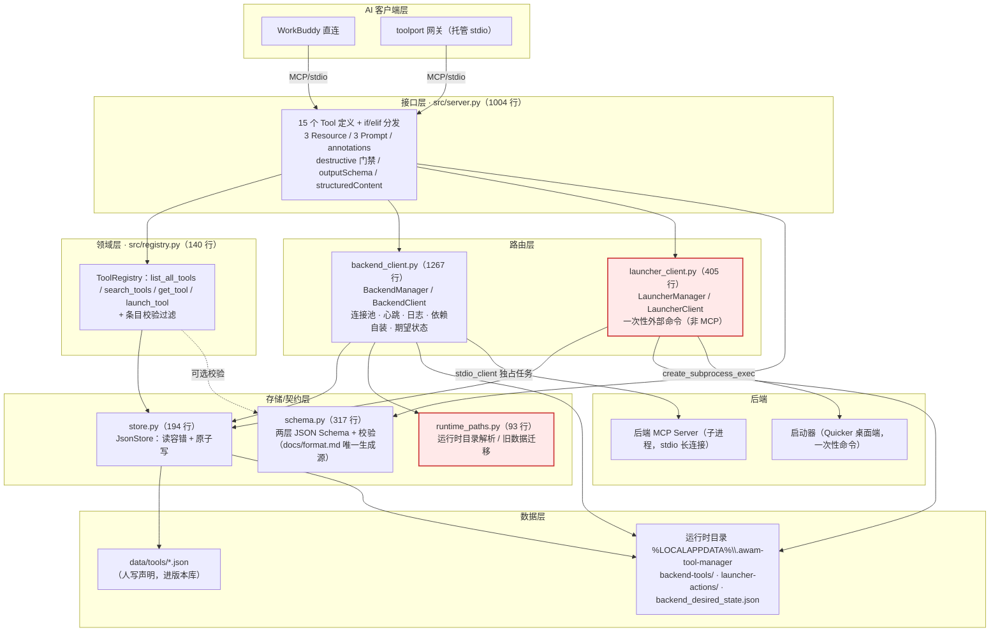
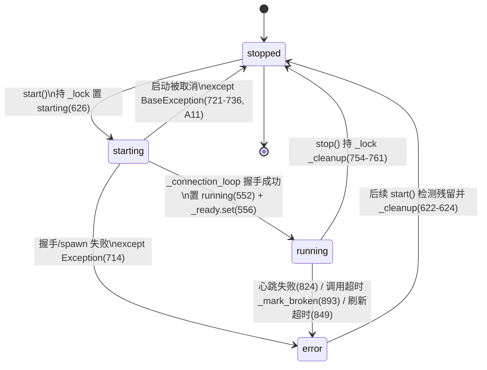

# awam-tool-manager 架构与设计原理评审报告

> 评审对象：`G:/Projects/19AI/skills/awam-tool-manager`（快照：工作区当前状态，含未提交改动）
> 评审日期：2026-10-16
> 评审范围：分层与职责、依赖方向、单一真相源、可扩展性、并发与生命周期、错误语义、进程资源管理、安全边界、数据存储、可测性与可观测性
> 方法：静态阅读全部 `src/` 源码、`tests/`、`data/`、`scripts/` 与 7 份文档；逐条到代码核实主持人在文档中发现的可疑漂移；**未运行任何测试或程序**（测试结论转述文档，标注「待 QA 核实」）。
> 去重说明：`docs/code-review.md` 中标记「✅ 已修复」的 D1–D26 / A1–A13 **不重复列举**，仅在 §3 漂移表内以「历史已修复但文档未同步」一笔带过。
>
> 证据纪律：本报告严格区分「已确认事实（附 file:line）」与「推断/建议」。凡无 file:line 支撑者，一律标注为「推断」。

---

## 1. 总体结论

**一句话**：这是一个**职责分层正确、工程细节扎实（原子写、anyio 取消作用域、错误兜底都做对了）但「单一真相源」承诺只兑现了一半、并把后端生命周期归属放错位置后用持久化文件补偿**的本地工具聚合层；代码质量明显高于文档质量。

**架构成熟度评级：C+（可用、局部优秀，但存在 1 项安全级缺陷 + 生命周期归属与 SSOT 两项结构性缺陷）。**

分维度速览：

| 维度 | 评级 | 一句话 |
|---|---|---|
| 分层与职责边界 | B- | 六模块分层清晰、无循环依赖，但 `server.py` 跨层直取 `store`、`registry` 混入校验 |
| 依赖方向 | A- | 严格单向「向下」，无循环；但「schema→format.md→data」三方一致只对字段表成立 |
| 单一真相源 | C | 工具清单散落 **9 处**；仅 `format.md` 字段表有防漂移机制 |
| 可扩展性（server.py） | C+ | 已到声明式注册表的临界点：新增一个工具要动 ~5 处代码/测试 + 4 处文档 |
| 并发与生命周期 | B | 三把锁 + 独占连接任务设计自洽；但 status 由 5+ 任务无锁写入 |
| 错误语义 | C+ | `errorType` 契约只有 1 个函数真正落地，其余失败路径静默漏字段 |
| 进程/资源管理 | D+ | A10 是「生命周期归属放错后拿文件补偿」的补丁（详见 ARC-P1-01） |
| 安全边界 | D | `install.command` 启动即执行任意命令、无门禁（详见 ARC-P0-01） |
| 数据与存储 | B- | 「JSON 即库」小规模可接受，但期望状态文件的跨实例读改写有竞态 |
| 可测性与可观测性 | C | 全用替身测试、无真实端到端；日志只有自定义工具、无标准 logging capability |

**最致命的一条（ARC-P0-01）**：`data/tools/*.json` 里的 `install.command` 会在**服务启动时被后台无条件执行**（`server.py:914` → `backend_client.py:436`），该命令来源是**进版本库的数据文件**，且**不受任何 `destructive` / `allowDestructive` 门禁约束**。这与「`launch_tool` 只返回命令、绝不执行」的取舍方向完全相反，构成最小权限倒置与本地 RCE 面。

---

## 2. 问题清单

> 分级：P0 阻断 / P1 结构性缺陷 / P2 一致性与可维护性 / P3 改进建议。

### P0 —— 阻断级（1 条）

#### ARC-P0-01　`install.command` 在服务启动时被无条件自动执行，且无任何门禁

- **证据**：
  - 服务启动即后台预热：`server.py:978` 创建 `_prewarm_backends()` 任务 → `server.py:914` `backend_manager.ensure_all_installed()` → `backend_client.py:1114` `client.ensure_installed()`。
  - 真正执行任意 shell：`backend_client.py:436` `asyncio.create_subprocess_shell(install_command)`；`install_command` 直接取自 `data/tools/*.json` 的 `install.command`（`backend_client.py:325-331`）。
  - 无门禁：该路径不经过 `_needs_destructive_confirm`（`server.py:108-126`），不检查 `destructive`，也不需要 `allowDestructive`。
  - 对照取舍：`launch_tool` 描述为「只返回命令，不实际执行启动」（`server.py:206`），而其命令来源同样是 `data/tools/*.json` 的 `launch.command`。
  - 命令载体进版本库：`git ls-files data/` 输出 `data/tools/{everything,everything-search-mcp,quicker,winget-mcp}.json` 均被跟踪。
- **影响**：
  1. **最小权限倒置**：副作用更小（仅返回文本）的 launch 命令不执行；副作用更大（任意 shell）的 install 命令却被自动执行。
  2. **本地 RCE 面**：任何能改动仓库（或提交一个恶意工具条目）的人，可在每个运行本服务的机器上、**服务启动瞬间**执行任意命令，无需任何调用方确认。CI/共享主机场景下即为阻断。
- **建议**（任一即可，建议 1+2）：
  1. 给 install 执行加显式开关（环境变量 `AWAM_ALLOW_INSTALL=1` 或每条目的 `install.autoApprove=true`），默认**不自动执行**，启动预热默认只检测不安装；
  2. 启动预热与 `start_backend` 前置安装都应落到「确认门禁」之下，与 `destructive` 同级；
  3. 文档明确标注 `data/tools/*.json` 为**代码等价物（可执行配置）**，并在 README 顶部安全声明。

### P1 —— 结构性缺陷（5 条）

#### ARC-P1-01　后端生命周期归属错位，用持久化文件「补偿」（A10 的架构定性）

- **证据**：
  - `backend_client.py:31-46` 自述：stdio MCP server 生命周期归客户端（网关）管，故把「启动意图」落盘；`backend_client.py:1073-1096` `restore_desired_backends()` 在每个新 server 世代据此重拉。
  - `server.py:980` 每次启动都创建 `_restore_backends()`。
  - `docs/architecture.md:279-281` 自承边界：「若 server 被硬杀……当代后端会孤儿化……要『永不重启』需把后端生命周期移出网关控制的 server 进程（外部 supervisor），属于后续架构演进」。
  - `TASKS.md:184-186` 亦列为「已知边界」。
- **影响**：**推断**（基于上述事实）——服务 S1（stdio server 由网关整池回收、进程内状态必失）与用户 S2（「后端常驻」的期望）在语义上冲突；当前用「意图文件 + 每代重拉」把 S2 伪装成 S1 的产物。结果是：生命周期的**权威归属**既不在服务内（会被回收），也不在用户侧（无声明），而落在一个磁盘文件上；硬杀即孤儿化、多实例即重复拉起（见 ARC-P1-02）。
- **建议**：把「后端该不该常驻」这一事实的归属**移出**瞬态 server 进程。至少 2 个替代方案：
  - **方案 A（推荐）— 惰性自启 + 空闲 TTL**：取消跨世代「意图文件」，改为「首次调用某后端时按需启动，空闲 N 分钟后回收」。`running` 由用户可见不变量降级为内部实现细节，用户看到的是「调用即用」。代价：首次调用有冷启动延迟（可用预热缓解）；好处：彻底移除 A10 及其竞态/孤儿面，与 stdio 瞬态语义自洽。
  - **方案 B — 外部 supervisor**：由一个常驻进程（或 Windows 服务）持有各后端生命周期，MCP server 退化为「控制客户端」。代价：新增进程与安装/守护管理，需跨 WorkBuddy 直连与 toolport 两条路径协调；好处：真正实现「永不重启」。
  - 备选：**方案 C — 网关契约**（把后端声明为网关托管依赖，由网关负责存活）或**方案 D — 客户端侧声明**（由 MCP 客户端按会话声明要常驻的后端）。二者都把复杂度推给上游/客户端，且依赖 toolport 是否支持，**推断**可行性低于 A/B。
- **备注**：本条目与「A10 已实现」不矛盾——A10 作为**临时止血**是有效的；本条针对的是**架构归属**，即「用文件补偿错位的生命周期归属」。

#### ARC-P1-02　期望状态文件存在跨实例「读-改-写」竞态

- **证据**：`backend_client.py:1030-1038` 读盘 → `backend_client.py:1060-1071` `_set_desired()` 先 `_load_desired_state()` 再改内存 dict 再 `_save_desired_state()`。全程**无文件锁、无跨进程锁**。`_save_desired_state`（`backend_client.py:1040-1058`）仅保证**单次写原子**（mkstemp+replace），不保证**读改写序列原子**。
- **影响**：WorkBuddy 直连与 toolport 托管**同时**运行多个 server 实例是常态（`SKILL.md:121-125` 亦如此描述）。实例 A `start_backend(x)` 与实例 B `stop_backend(y)` 并发时，两次「读→改→写」交错会丢更新（lost update）——例如 B 的置入被 A 的旧快照覆盖，导致意图文件与实际不符，进而下代恢复行为错误。
- **建议**：单文件多写者场景下，改用「每工具一个文件（`desired/{tool_id}.json`）+ 只写自身键」避免整表读改写；或引入跨进程锁（Windows 下 `msvcrt`/命名互斥体）。**代价**：前者改造成本低、推荐。

#### ARC-P1-03　`errorType` 契约只在 1 处真正落地，其余失败路径静默漏字段

- **证据**：
  - 文档承诺失败体含 `errorType`：`docs/format.md:204-218`、`SKILL.md:83-93`。
  - 实际只有 `BackendManager.call_backend_tool` 做了映射：`backend_client.py:1216-1249`。
  - 其余失败返回**不含** `errorType`：`backend_client.py:1131, 1149, 1152, 1162, 1170, 1187, 1202, 1209, 1255, 1261`（均 `{"success": False, "error": ...}`）。
  - 这些 dict 被 `server.py:147-151` `ensure_success()` **原样** `json.dumps` 抛成 `ToolError`，于是客户端拿到的 isError 正文里没有 `errorType`；例如 `start_backend` 的「安装中」分支（`backend_client.py:647-651`）经 `server.py:622` 包装后，正文为 `{"success":false,"status":"installing","message":...}`，既无 `errorType` 也无 `error`。
  - 枚举数量三方不一致：`format.md:216-218` 列 9 种、`SKILL.md:91-93` 列 10 种，代码实际至少 emit **13** 种——额外还有 `unknown_prompt`（`server.py:890`）、`launcher_error`（`server.py:674`）、`unknown_error`（`backend_client.py:1247`）。
- **影响**：调用方（AI 客户端 / 网关）**无法**对所有失败分支稳定地 `switch(errorType)`，只能退化为解析自由文本。文档承诺的「可编程错误」成为部分兑现。
- **建议**：定义唯一 `ErrorType` 常量表 + 统一失败构造函数（如 `backend_manager` 内一律经 `_fail(error_type, error, **extra)` 返回），并补一条测试断言「任何 `success=False` 的 manager 返回值必须含合法 `errorType``」；同时把文档枚举改为从常量表生成，避免再次漂移。

#### ARC-P1-04　`server.py` 已到声明式注册表临界点：真相源并行、参数校验缺位

- **证据**：
  - 体量：`server.py` 1004 行；15 个 `Tool(...)` 字面量占 `server.py:158-431`（约 273 行）；`dispatch_tool` 的 if/elif 链占 `server.py:500-717`（约 217 行）。
  - **工具清单在代码内并行维护 3 份**：`list_tools()` 的 `Tool` 定义（`server.py:158-431`）、`TOOL_ANNOTATION_HINTS` 字典（`server.py:73-91`，按名字字符串键）、`dispatch_tool` 分支（`server.py:500-717`）。三者靠「名字字符串」对齐，新增工具漏改任一处即静默退化（例如漏改 hints 则该工具不下发任何 annotation，无报错）。
  - **`inputSchema` 声明但不校验**：`list_tools` 声明了 `required`（如 `server.py:174` `["keyword"]`），但 `dispatch_tool` 用 `arguments.get("keyword","")` 兜底（`server.py:501`），必填缺失被静默当成空串；只有 `call_backend_tool` 的 `destructive`（`server.py:591`）与 launcher 的 `action_id/name`（`launcher_client.py:312-313`）做了运行期校验，**校验点分散且不一致**。
  - 成功/错误包装在每个分支各自重写：`json.dumps({..., "success": True}, ensure_ascii=False, indent=2)` 出现在 8 个分支里（`server.py:504, 523, 575, 580, 617, 623, 634, 641` 等）。
- **影响**：新增/修改一个对外工具需要跨 3 处同步 + 无编译期保证；必填参数不校验导致错误延后到后端或产生空结果。
- **建议**：引入**声明式工具注册表**——单一数据表 `{name, build_input_schema(), annotations, handler(params)->dict}`，由它派生 `list_tools()`、annotation、`dispatch` 与参数校验。**代价评估**：改动集中在 `server.py`（约 400 行可压缩），风险中（有 `test_server_dispatch.py`/`test_protocol_roundtrip.py` 保护），收益是「新增一个工具 = 加一行表项」。可在保留现有 15 个 handler 函数体的前提下先做「表驱动 dispatch + 自动 annotations」，不动业务逻辑，分批落地。

#### ARC-P1-05　权限模型缺位，破坏性门禁粒度不对称

- **证据**：
  - 无权限模型：`TASKS.md:227`「P3 - 权限控制（哪些工具 AI 可以直接执行）」仍在待办。
  - 后端支持**子工具级**破坏性：`server.py:108-126` `_needs_destructive_confirm`（`destructiveTools`）；`data/tools/winget-mcp.json:19` 即用 `destructiveTools:["install-winget-package"]`。
  - 启动器**只有条目级**破坏性：`server.py:696` 仅判 `target_tool.get("destructive")`。而 `data/tools/quicker.json:21` `destructive:true` → **全部 212 个 Quicker 动作**的每一次 `run_launcher_action` 都被强制要 `allowDestructive`（含纯查询类动作）。
  - 门禁是**布尔粗闸**：`allowDestructive` 一旦为 true，对整条命令放行，无白名单、无按动作/按子工具的细粒度授权、无审计日志。
- **影响**：安全默认值偏保守（好），但**粒度不对称**造成可用性损失（Quicker 全量拦截）与授权过宽（一次确认覆盖后续所有调用）并存；缺权限模型意味着门禁无法表达「某客户端只允许只读子集」。
- **建议**：把 `destructiveTools` 机制下沉为通用「子操作破坏性清单」，launcher 同样支持（按 `action_id`/动作类型）；并在其上加一层**能力授权**（客户端/会话 → 允许的工具子集 + 允许的破坏性上限），布尔 `allowDestructive` 作为兜底而非唯一手段。

### P2 —— 一致性与可维护性（7 条）

#### ARC-P2-01　文档与实现大面积漂移，且**只有 `format.md` 字段表**有防漂移机制

- **证据**：见 §3 完整漂移表。机制层面：防漂移测试只覆盖 `docs/format.md` 的**两个生成块**（`tests/test_docs_sync.py:51-99`），**不**读 `architecture.md`/`SKILL.md`/`README.md`/`TASKS.md`；`format.md` 自身手写的「对外契约」表（`format.md:181-194`）也在漂移（仅 12 个工具）。
- **影响**：§3 表内至少 25 处失效陈述，全部是「文档说是 A、代码是 B」，新人/后续 AI 依据文档会得到错误事实。
- **建议**：把「对外工具清单」提升为**可生成产物**（由 `server.list_tools()` 或声明式注册表渲染），对 `SKILL.md`/`architecture.md`/`format.md` 的工具表统一加生成块 + 漂移测试；对行数/用例数这类易腐数字，改为「不带数字」或从脚本注入。

#### ARC-P2-02　`docs/code-review.md` 信息架构已不可维护

- **证据**：1055 行、62KB 级；标题层级自相矛盾：`## 0.`（`code-review.md:9`）、`## 0.0`（:71）、`## 0.0.0`（:117）、`## 0.0.0.0`（:136）——用「往数字前再点一位」表达第 N 次更新；同一缺陷 D24 排在 D26 之后（:626 vs :614）；「最新」标记停留在第九次更新（:9），其后 A10–A13 未纳入。
- **影响**：无法定位「当前还有哪些未修复项」；历史叠加掩盖现状。
- **建议**：拆分为「当前状态报告（按严重级别，卷首只列未修复）」+「历史变更日志（按时间，归档）」，并让「已修复」项只保留一句结论 + commit。

#### ARC-P2-03　根目录 9 个 `test_*.py` 调试脚本残留，暴露测试流程问题

- **证据**：根目录存在 `test_backend_start.py / test_basic.py / test_debug.py / test_direct_mcp.py / test_e2e.py / test_list_backend.py / test_local.py / test_search_mcp.py / test_start_mcp.py`（合计 522 行），被 `.gitignore` 排除；`architecture.md:88`、`TASKS.md:181` 均以「调试期临时脚本」一笔带过。
- **影响**：**推断**——说明相当一部分「实测验证」是以临时脚本形式一次性完成的，未沉淀为回归；这与「tests 均为替身、无真实端到端」（见 ARC-P3-02）互为因果。`.pytest_cache/v/cache/lastfailed` 的存在也提示存在过失败态。
- **建议**：把仍在用的脚本收敛为带 `@pytest.mark.integration` 的正式用例（尤其 e2e / 真实子进程启停），其余删除。

#### ARC-P2-04　`launcher_client` / `server` 跨层直取存储，`registry` 混入校验

- **证据**：
  - `server.py:677` 在 interface 层直接 `store.load_launcher_catalog(tool_id)`，绕过 `launcher_manager`/`registry`；而 `server.py:41` 直接 import `JsonStore`。
  - `registry.py:24-52` 的 `_report_invalid`/`_valid_tools` 与 `registry.py:91-95` 在**查询**路径里做**校验**，职责混合；`validate_tool_entry` 在 `registry.py:47` 与 `registry.py:92` 两处调用。
  - `LauncherManager` 同时持有 `registry` 与 `store`（`launcher_client.py:364-367`），`LauncherClient` 亦直接持有 `store`（`launcher_client.py:97`）。
- **影响**：interface 层与 storage 层耦合，绕过领域层；`store`/`registry`/`launcher` 的边界在「谁负责读缓存、谁负责校验」上不唯一。
- **建议**：`server` 不直接依赖 `store`（把 `load_launcher_catalog` 暴露为 `LauncherManager` 方法）；校验统一在 registry 的**入口一次性**完成（load 层过滤），查询层只查已过滤集合。

#### ARC-P2-05　错误通道三轨（文本 JSON / structuredContent / isError）语义冗余且成功/失败不对称

- **证据**：成功路径同时返回 `content=[TextContent(...)]` 与 `structuredContent`（`server.py:489-493`），文本内容与结构化内容同源同义；失败路径抛异常，由 SDK 转 `isError=True`（`server.py:132-136`），**不带** `structuredContent`。`outputSchema`（`SHARED_OUTPUT_SCHEMA`，`server.py:100-105`）要求顶层 `success` 且 `additionalProperties:true`。
- **影响**：客户端在成功时必须处理两份等价数据（冗余、易分叉）；失败时拿不到结构化内容（非对称），若某些客户端优先消费 `structuredContent` 则对错误不可见。`outputSchema` 在错误路径是否被校验未在代码中显式处理——**推断**存在「isError 结果是否满足 outputSchema」的协议灰区，待 QA/协议核。
- **建议**：明确「文本通道 = 人类可读、structuredContent = 机器消费」的**唯一**契约；错误也走 `CallToolResult(isError=True, structuredContent={...})` 而不是仅文本，保证成功/失败对称。

#### ARC-P2-06　`data/backend-tools`、`data/launcher-actions` 的 git 归属已变更，文档仍标「待定」

- **证据**：`TASKS.md:187-189` 称「`data/backend-tools/*.json` 是自动生成的缓存却受 git 跟踪……（**待定**）」。实际已决议并落地：`.gitignore` 新增 `/data/backend-tools/`、`/data/launcher-actions/`；`git status` 显示三份缓存为已暂存删除（`D`）；运行时目录改由 `runtime_paths.py:27-45` 提供（`%LOCALAPPDATA%\.awam-tool-manager`）；`store.py:32-33` 把它们指向 `runtime_dir`。
- **影响**：文档给出的「待定」会误导下一位维护者重复决策。
- **建议**：更新 `TASKS.md` 为「已决议：移出仓库 + gitignore」。

#### ARC-P2-07　多实例共享运行时目录导致后端重复拉起

- **证据**：`store.py:30` 运行时目录默认按 OS 惯例（全局），非按实例隔离；`backend_client.py:46` 期望状态文件同样全局；`server.py` 未对实例加锁。`SKILL.md:121-125` 描述 WorkBuddy 直连 + toolport 托管**多实例并存**。
- **影响**：**推断**——两个实例各自拥有独立进程池（`BackendManager.clients` 在内存，`backend_client.py:966`），同一 `tool_id` 会被拉起**两份**后端子进程；配合 ARC-P1-02 的意图竞态，恢复行为可能相互干扰。
- **建议**：明确「stdio 后端每实例一份」为**已知代价**并写入文档；或引入「单例后端 broker」（与 ARC-P1-01 方案 B 同源）。

### P3 —— 改进建议（5 条）

#### ARC-P3-01　可观测性：无标准 logging capability、无 metrics/trace
- **证据**：日志只有自定义工具 `get_backend_logs`（`server.py:303-324`）与 stderr 打印（`backend_client.py:274-288`）；`architecture.md:433`「标准 logging capability 目前用自定义 Tool 查日志」；全仓无 metrics/trace/correlation id。
- **建议**：实现 MCP `logging` capability（协议标准通道）；为 `call_backend_tool` 加调用计数/耗时/失败率（可暴露为 resource 或 stderr 结构化行）。

#### ARC-P3-02　缺乏真实端到端测试层（全替身）
- **证据**：`tests/test_backend_client.py:3` 明言「不需要真实的后端 MCP 子进程：用假的 session / context 驱动」；`stdio_client` 被替身替换（`test_backend_client.py:700`）、`create_subprocess_shell` 被替身替换（`test_backend_client.py:672+`）。`TASKS.md:155`「真实后端子进程启停 + 调用回归通过」为**人工验证**，非自动化用例（**转述文档，待 QA 核实**）。
- **建议**：新增带 `@pytest.mark.integration` 的用例，用**自研的最小 stdio MCP echo server**（纯 Python，不依赖 npm/Quicker/Everything）跑通 `_connection_loop` 全链路；外部依赖型用例（npm/Quicker/Everything）单列、默认 skip。

#### ARC-P3-03　命名重载：「launcher（kind）」与「launch_tool（app 启动）」易混
- **证据**：`kind=launcher`（`schema.py:47`）指「启动器（Quicker）」；而对外工具 `launch_tool`（`server.py:205`）指「返回 `kind=app` 的启动命令」。`architecture.md:449` 与 `server.py:577-580` 分别处理，但命名同源不同义。
- **建议**：对外文档统一术语「启动器=launcher 工具」与「取启动命令=launch_tool」，或考虑将 `launch_tool` 更名以消除歧义（改名需评估客户端兼容）。

#### ARC-P3-04　`store` 每次请求全量重读，无缓存
- **证据**：`store.py:105-114` `list_tools()` 对 `tools_dir` 全量 `glob` + 逐文件 `load_json`；`architecture.md:352` 自评「⚠️ 小规模可接受，无缓存」。
- **建议**：**可接受**（当前 <10 个工具）。若工具数上量，加基于 mtime 的目录级缓存即可，不必上数据库。

#### ARC-P3-05　`data/tools` 目录不区分「人写声明」与「可执行配置」的信任级别
- **证据**：`data/tools/*.json` 同时含声明元数据（`tags`/`description`）与**可执行**字段（`launch.command`、`connection.command`、`install.command`）；`schema.py:16-18` 声明「未知字段放行」，`install.command` 为自由字符串（`schema.py:119`）。
- **建议**：与 ARC-P0-01 联动——对可执行字段的取值做白名单/前缀校验（如只允许 `npm i -g` / `winget install`），把它们与人写展示字段在 schema 上显式分区。

---

## 3. 文档与实现漂移表

> 左：过期陈述（出处 + 原文片段）；右：代码/实际值（file:line）。标注「历史已修复但文档未同步」者不再单列问题。

| # | 出处 | 过期陈述（原文片段） | 实际值（file:line） |
|---|---|---|---|
| 1 | `docs/architecture.md:164` | 「接口层 src/server.py · **12 个 Tool 定义** + 分发」 | 15 个 Tool：`server.py:159,177,190,204,218,244,262,276,290,303,325,343,357,371,397` |
| 2 | `docs/architecture.md:287` | 「### 6.1 Tools（**12 个**）」+ 12 行工具表（294-304） | 同上 15 个；表缺 `sync_launcher_actions`/`list_launcher_actions`/`run_launcher_action` |
| 3 | `docs/architecture.md:448` | 「`dispatch_tool` \| **12 个工具**的分发（if/elif 链）」 | `server.py:500-717` 分发 15 个 |
| 4 | `docs/architecture.md:63-64` | 「SKILL.md # 技能声明（**已过期**）」「README.md（**已过期**）」 | SKILL.md 已于 :53-69 更新为 15 工具；该括注本身已失真 |
| 5 | `docs/architecture.md:157-186`（5.1 分层图） | 分层图**无 launcher 层、无 runtime_paths** | `launcher_client.py`（405 行）；`server.py:58` `LauncherManager`；`runtime_paths.py`；`server.py:42` |
| 6 | `docs/architecture.md:71-76, 177-181` | 目录/存储层只列 `data/tools`、`data/backend-tools` | 另有 `data/launcher-actions/`（`store.py:33`）与运行时目录（`runtime_paths.py:40-45`） |
| 7 | `docs/architecture.md:79` | `store.py` = **139** 行 | 实际 **194** 行（`wc -l src/store.py`） |
| 8 | `docs/architecture.md:81` | `schema.py` = **240** 行 | 实际 **317** 行 |
| 9 | `docs/architecture.md:82` | `backend_client.py` = **1246** 行 | 实际 **1267** 行 |
| 10 | `docs/architecture.md:196` | `server.py` = **828** 行 | 实际 **1004** 行 |
| 11 | `docs/architecture.md:190-197`（5.2 模块表） | 仅列 store/schema/registry/backend_client/server/generate_format_doc | 缺 `launcher_client.py`、`runtime_paths.py`；且 `server.py` 依赖列表漏 launcher/runtime_paths |
| 12 | `docs/architecture.md:85` | 「tests/ **7 个文件，106 个用例**」 | 实际 9 个 `test_*.py`（+ `conftest.py`），`def test_` 共 **162**（含 parametrize 展开更多；**待 QA 核实运行数**） |
| 13 | `docs/architecture.md:329-338`（7.1 启动流程） | 仅 `_prewarm_backends()` | `server.py:978-980` 另有 `_restore_backends()`（A10） |
| 14 | `docs/architecture.md:3` | 快照标记「截至 **2026-10-15**, commit `65d108c`」 | commit 存在但浅于 launcher/winget 接入；文档未逐批重标 |
| 15 | `SKILL.md:43` | 「tests/ # **106 个用例**」 | 同 #12（9 文件 / 162 测试函数） |
| 16 | `SKILL.md:35-40`（目录结构） | `src/` 仅列 server/store/registry/backend_client/schema；`data/` 仅列 tools、backend-tools | 缺 `launcher_client.py`、`runtime_paths.py`、`data/launcher-actions/` |
| 17 | `SKILL.md:10-11` | 「MCP 只是工具的一种类型（`kind=mcp`），普通应用是另一种（`kind=app`）……**不再区分『启动器』与『子工具』**」 | 与 `kind=launcher` 并存冲突（`schema.py:47`、`data/tools/quicker.json:5`）；该文件 :71-79 又详述 launcher，**自相矛盾** |
| 18 | `README.md:13` | 「`requirements.txt` 锁定 `mcp>=**1.9.0**,<2.0.0`」 | `requirements.txt:14` = `mcp>=1.29.0,<2.0.0`；`SKILL.md:132`、`architecture.md:66` 亦为 1.29 |
| 19 | `README.md:38-42` | 「已登记工具」表仅 2 行（everything、everything-search-mcp） | `data/tools/` 实为 4 个（+ winget-mcp、quicker） |
| 20 | `README.md:48-57` | 目录结构无 `launcher_client.py`/`runtime_paths.py`/`launcher-actions/` | 同 #16 |
| 21 | `docs/format.md:181-194` | 「对外契约」表 12 个工具（手写，非生成块） | 15 个；缺 3 个 launcher 工具 |
| 22 | `docs/format.md:216-218` | `errorType` 列 **9** 种（缺 `backend_busy` 等） | 代码至少 emit **13** 种；`format.md` 漏 `backend_busy`/`unknown_prompt`/`unknown_error`/`launcher_error` |
| 23 | `SKILL.md:91-93` | `errorType` 列 **10** 种 | 同上，缺 `unknown_prompt`（`server.py:890`）/`unknown_error`（`backend_client.py:1247`）/`launcher_error`（`server.py:674`） |
| 24 | `TASKS.md:28` | 「### 对外 MCP 工具（**12 个**）」 | 15 个 |
| 25 | `TASKS.md:155` | 「合计 **158 passed（8 个文件）**；真实后端子进程启停 + 调用回归通过」 | 9 个测试文件；「真实子进程回归」为人工验证（**转述文档，待 QA 核实**） |
| 26 | `TASKS.md:187-189` | `data/backend-tools/*.json`「受 git 跟踪……（**待定**）」 | 已改：`.gitignore` 排除 `/data/backend-tools/`、`/data/launcher-actions/`，缓存移入运行时目录（`runtime_paths.py:27`、`store.py:32-33`） |
| 27 | `TASKS.md:279` | 「`kind`：`app`（普通应用）/ `mcp`（MCP 工具）」 | `schema.py:47` 枚举为 `app/mcp/launcher` |
| 28 | `TASKS.md:311` | 目录树根级「`backend_desired_state.json`……已 gitignore」 | 实际位置为运行时目录（`backend_client.py:46` `get_runtime_dir()/...`），**不在仓库根** |
| 29 | `TASKS.md:317-327` | 目录树列 `data/backend-tools/`、`data/launcher-actions/` 及其文件 | 二者已迁出 `data/`，见 #26 |
| 30 | `TASKS.md:329-334` | `src/` 树列 server/store/registry/backend_client/launcher_client/schema | 缺 `runtime_paths.py` |
| 31 | `docs/architecture.md:66` | requirements「mcp>=1.29.0,<2.0.0, **pytest>=7.0.0**」 | `requirements.txt` 另有 `jsonschema>=4.0.0`（:19）未列 |
| 32 | `docs/architecture.md:449` | 「…`data/launcher-actions/`」 | 描述正确（此项为交叉印证，非漂移） |

> **机制性根因**：漂移 #1–#30 中，凡属 `docs/format.md` **生成块内**的字段（`format.md:26-72`、`:140-152`）**均无漂移**（由 `tests/test_docs_sync.py:51-58` 自动拦截）；凡**手写**的工具表、行数、用例数、目录树、错误枚举**全部漂移**。结论：**防漂移机制只覆盖了它覆盖的那一部分**，其余靠人工同步，已系统性失效。

---

## 4. 分层图修订版

### 4.1 修订版分层（Mermaid，含 launcher 层与 runtime_paths）

> 红色节点（`launcher_client.py`、`runtime_paths.py`）为当前所有架构图/目录树**遗漏**的两层——它们已是代码中的一等公民。

### 4.2 真实 import 依赖图（已确认，无循环）

- **结论（已确认事实）**：模块级 import 严格单向、**无循环依赖**（`server` 为唯一聚合点；`runtime_paths`/`store`/`schema` 为叶子）。
- **两处「软依赖」**：`registry → schema` 用 `try/except ImportError` 包住（`registry.py:8-11`）；`launcher_client` 对 `registry`/`store` 仅为运行期参数注入（`launcher_client.py:364-367`），无 import，故图中以虚线标注。

### 4.3 后端状态机（含触发者与并发保护）

并发保护对照：

| 转换 | 触发者（代码位置） | 并发保护 |
|---|---|---|
| stopped→starting | `start()` (`backend_client.py:616-626`) | `_lock` |
| starting→running | 独占连接任务 (`:552`) | 无锁，靠 `_ready` 握手（`:556`）保证 `start()` 读到时状态一致 |
| running→error | 心跳任务 (`:824`)、`call_tool` 超时 (`:893`)、`_refresh_tools_cache` (`:849`) | 无锁（幂等置 ERROR + 后台 `_safe_cleanup`） |
| *→stopped | `stop()` (`:754-761`)、A11 取消兜底 (`:732`) | `_lock`（取消兜底未持锁，仅在取消路径） |
| 连接拆除 | `_cleanup()` (`:768-784`) | `_cleanup_lock`（串行幂等） |
| 单后端调用 | `call_tool` (`:877`/`:885`) | `_call_lock`（单飞 + `BackendBusyError` 不排队） |
| 依赖安装 | `ensure_installed` (`:409`/`:501`) | `_install_lock` + 5s 等待上限 |

**已确认事实**：锁获取顺序恒为 `_lock → _cleanup_lock`（`start`/`stop` 皆然），无锁序反转，**无经典死锁**。
**结构性弱点（推断）**：`self.status` 被 **5 个以上任务**写入且**多数不持锁**（连接任务 `:552`、心跳 `:824`、`_mark_broken` `:788`、`start` `:626/715/732`、`stop` `:761`）。当前正确性依赖「置位顺序 + `_ready` 握手 + 清理幂等」而非显式状态机不变式；一旦新增一个状态写入点，极易破坏。建议把「状态迁移」收敛为唯一 helper（校验合法迁移后再写）。

**关于「launcher 与 MCP 后端塞进同一 BackendManager」——原假设不成立（已确认事实）**：二者**并未**共用 manager。`server.py:57-58` 分别实例化 `BackendManager`（仅 `kind=mcp`，`backend_client.py:995` 对非 mcp 返回 `None`）与 `LauncherManager`（`kind=launcher`）；launcher 无连接池、无心跳、无生命周期（`launcher_client.py:361-405`）。因此不存在「长连接与一次性命令被塞进同一生命周期语义」的问题。**但存在抽象不对称**：launcher 不支持子级破坏性（ARC-P1-05）、无统一的错误类型（既抛 `LauncherError` 又返回 `success:false`，`launcher_client.py:346,356`）。

---

## 5. 「新增一个 kind / 新增一个工具」改动点清单

### 5.1 新增一个**对外工具**（不改数据结构）

| 位置 | 文件:位置 | 说明 |
|---|---|---|
| 1 | `src/server.py:158-431` | 在 `list_tools()` 加一个 `Tool(...)` 定义 |
| 2 | `src/server.py:73-91` | 在 `TOOL_ANNOTATION_HINTS` 加键（漏加则静默无 annotation） |
| 3 | `src/server.py:500-717` | 在 `dispatch_tool` 加一个 `elif` 分支 + 手工 JSON 包装 |
| 4 | `tests/conftest.py:32-48` | 更新 `EXPECTED_TOOL_NAMES` 集合（3 个测试引用它） |
| 5 | `tests/test_server_dispatch.py` | 补分发用例 |
| 6 | `SKILL.md:53-69` | 工具表 |
| 7 | `docs/format.md:181-194` | 对外契约表（**手写、无防漂移**） |
| 8 | `docs/architecture.md:287-304`、`:448` | 工具表 + 「N 个」计数 |
| 9 | `TASKS.md:28`、`:239` | 「12 个」计数 + 两层结构表 |

**合计：4 处代码/测试 + 4~5 处文档，至少 9 个改动点，且 1/2/3 靠字符串名对齐、无编译期保证。**

### 5.2 新增一个 **kind**（参照 launcher 的落地范围）

| 位置 | 文件:位置 | 说明 |
|---|---|---|
| 1 | `src/schema.py:47` | `kind.enum` 增加取值 |
| 2 | `src/schema.py:215` | `_basic_checks` 白名单同步 |
| 3 | `src/schema.py`（新增块） | 该 kind 的子对象 schema（如 `launcher` 块 `:122-140`） |
| 4 | `src/store.py:32-33` + 新方法 | 该 kind 的第二层数据目录 + load/save（如 `:150-194`） |
| 5 | `src/launcher_client.py`（**新文件**） | 该 kind 的适配器 |
| 6 | `src/server.py:57-58` | 实例化新 Manager |
| 7 | `src/server.py:158-431 + 500-717 + 73-91` | 对外工具定义 + 分发 + annotations |
| 8 | `src/runtime_paths.py:27` | `LEGACY_SUBDIRS`（若引入新的运行时子目录） |
| 9 | `data/tools/{id}.json` | 新条目 |
| 10 | `data/format.md` | 由 `scripts/generate_format_doc.py` 自动更新（**唯一自动项**） |
| 11 | `docs/architecture.md` / `SKILL.md` / `TASKS.md` | 分层图、目录树、工具表（**全手写，易漏**） |
| 12 | `tests/` | 新 kind 的适配器/分发/策略用例 |

**合计：代码 ~8 处 + 数据 1 处 + 文档 4 处 + 测试若干；仅 `format.md` 字段表自动同步。**

> 结论：**「新增一个 kind」是一次横切多模块的改动**（schema→store→新客户端→server→runtime_paths→docs→tests），`SSOT 分散`是本项目最主要的可维护性成本。

---

## 6. 演进建议 TOP5（按性价比排序）

| 排名 | 做什么 | 为什么 | 代价 |
|---|---|---|---|
| **1** | **给 `install.command` 加显式开关，默认不在启动时自动执行**（ARC-P0-01） | 消除「启动即执行任意 shell、来源进版本库、无门禁」的 RCE 面与最小权限倒置；改动小、风险消除大 | **低**：`_prewarm_backends`/`ensure_installed` 加环境变量判断 + 文档安全声明 |
| **2** | **把「对外工具清单」改为可生成产物 + 漂移测试**（ARC-P2-01 / P1-04 的第一步） | 一次性消除 §3 中 #1/#2/#3/#21/#24 等整类漂移；把 9 个改动点收敛 | **低-中**：加一个渲染函数 + 在 `architecture.md`/`SKILL.md`/`format.md` 插入生成块；复用现有 `test_docs_sync.py` 模式 |
| **3** | **统一失败返回：所有 `success:false` 必带合法 `errorType`**（ARC-P1-03） | 让文档承诺的「可编程错误」真正成立，客户端可分支；同时修正 3 份文档的错误枚举漂移 | **中**：新增 `errorType` 常量表 + manager 内统一失败构造函数 + 断言测试 |
| **4** | **`server.py` 声明式工具注册表**（ARC-P1-04） | 把「新增一个工具=改 3 处代码」降为「加一行表项」；顺带落地 inputSchema 参数校验，消除必填静默通过 | **中**：约 400 行收敛，但可分批（先表驱动 dispatch + 自动 annotations，不动业务逻辑），有回归测试保护 |
| **5** | **后端生命周期归属修正：优先「惰性自启 + 空闲 TTL」，并移除期望状态文件的跨实例读改写**（ARC-P1-01 / P1-02） | 从根上解决「网关回收即失忆」「硬杀即孤儿」「多实例重复拉起」；`running` 从用户可见不变量降为内部实现细节，与 stdio 瞬态语义自洽 | **中-高**：需重新定义 `start/stop_backend` 语义与文档；若暂时保留 A10，则至少先按工具分文件消除读改写竞态（**低代价**） |

---

## 附录 A　评审方法与边界

- **已确认事实**：全部结论均给出 `file:line`，可复核。核心代码 `src/{server,backend_client,launcher_client,registry,store,schema,runtime_paths}.py` **逐行通读**。
- **推断项**：凡标注「推断」者（ARC-P1-01 的语义冲突定性、ARC-P1-05 的可用性影响、ARC-P2-03/P2-07 的工程流程与多实例后果、ARC-P2-05 的协议灰区），均为基于已确认事实的**架构判断**，未通过运行验证。
- **未做**：未运行测试、未启动服务、未执行任何后端；`TASKS.md:155`「158 passed / 真实子进程回归」等**转述文档，待 QA 核实**。
- **与既有评审去重**：`docs/code-review.md` 中 D1–D26 / A1–A13 全部「✅ 已修复」，本报告不重复；仅在 §3 以「文档未同步」形式提及。
- **工具清单计数口径**：`server.py` 中 `Tool(` 字面量 15 个（`grep -c` = 15），与 `tests/conftest.py:32-48` 的 `EXPECTED_TOOL_NAMES`（15）一致，可交叉印证。

## 附录 B　问题统计

| 级别 | 条数 | 编号 |
|---|---|---|
| P0 阻断 | 1 | ARC-P0-01 |
| P1 结构性缺陷 | 5 | ARC-P1-01 ~ P1-05 |
| P2 一致性与可维护性 | 7 | ARC-P2-01 ~ P2-07 |
| P3 改进建议 | 5 | ARC-P3-01 ~ P3-05 |
| **合计** | **18** | —— |
| （附）文档漂移表条目 | 32 | §3 |
